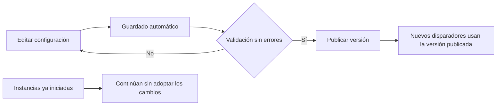

# DocuWare y la configuración de procesos documentales

Consulta: 16 de octubre de 2026, fecha local de la investigación. Este análisis reconstruye el contrato funcional público; **no se ejecutó una instancia de DocuWare, no se inspeccionó su servidor ni se recuperó su código propietario**. Las propuestas están identificadas como tales. [Volver al informe principal](00-informe-principal.md).

El aprendizaje central es separar cuatro cosas: el archivo, sus datos de negocio, la configuración del proceso y cada ejecución de esa configuración. La documentación ofrece mecanismos concretos para hacerlo, pero mezcla generaciones de cliente; una característica del cliente clásico no puede atribuirse automáticamente al nuevo.

## 1. Alcance y versiones

Las páginas del diseñador web consultadas declaran soporte para Cloud y versiones 7.14 y 7.15. Las del nuevo cliente analizadas se limitan a Cloud. El informe conserva esos alcances: no establece cuál tiene instalada una empresa ni qué módulos incluye una licencia.

La página de [relaciones documentales](https://knowledgecenter.docuware.com/docs/document-relations) indica que están disponibles en el cliente clásico y todavía no en el nuevo. El mismo proveedor documenta que la [gestión de versiones del nuevo cliente](https://knowledgecenter.docuware.com/docs/version-management) ofrece versionado automático, pero todavía no el checkout/checkin manual. Son diferencias funcionales, no simples cambios de aspecto.

## 2. Modelo funcional reconstruido

Esta tabla es una traducción conceptual de la documentación, **no el esquema de su base de datos**.

| Elemento                            | Papel comprobado en documentación                                          | Fuente                                                                                           |
| ----------------------------------- | -------------------------------------------------------------------------- | ------------------------------------------------------------------------------------------------ |
| Bandeja                             | Área previa al archivo definitivo, donde se importan y preparan documentos | [Bandejas](https://knowledgecenter.docuware.com/docs/document-trays-in-docuware-web-client)      |
| Archivador                          | Ámbito de documentos, campos y permisos; un workflow se vincula a uno      | [Dashboard](https://knowledgecenter.docuware.com/help/docs/webbased-workflow-designer-dashboard) |
| Índices                             | Datos utilizados por búsquedas, condiciones, relaciones y asignaciones     | [Disparadores](https://knowledgecenter.docuware.com/docs/webbased-workflow-designer-trigger)     |
| Configuración y versión de workflow | Descripción publicada del proceso y su evolución                           | [Canvas](https://knowledgecenter.docuware.com/docs/webbased-workflow-designer-canvas-tools)      |
| Instancia                           | Una ejecución del workflow, con actividades pendientes                     | [Dashboard](https://knowledgecenter.docuware.com/help/docs/webbased-workflow-designer-dashboard) |
| Tarea y decisión                    | Interacción de una persona con opciones, campos y validación               | [Tareas](https://knowledgecenter.docuware.com/help/docs/webbased-workflow-designer-tasks)        |
| Relación                            | Regla de búsqueda entre documentos mediante índices o campos del sistema   | [Relaciones](https://knowledgecenter.docuware.com/docs/document-relations)                       |

La bandeja permite preparar una carga antes de archivarla. También se documentan registros de índices sin archivo, útiles como datos maestros. El seguimiento de carga distingue pendientes y fallidos y permite reintentar los fallidos. **No he verificado** si un reintento después de perder la respuesta puede duplicar un archivo ya aceptado. [Fuente de bandejas](https://knowledgecenter.docuware.com/docs/document-trays-in-docuware-web-client).

Las relaciones pueden consultar el mismo archivador u otro usando campos, operadores y reglas AND/OR. **Inferencia:** la relación documentada se comporta como una consulta contextual; no demuestra una clave foránea ni integridad referencial en el almacenamiento. [Fuente de relaciones](https://knowledgecenter.docuware.com/docs/document-relations).

## 3. Configurar no equivale a poner en producción

El canvas guarda automáticamente los cambios. Su validación señala configuraciones incompletas y condiciona la publicación a que no haya errores. Publicar activa una versión concreta. [Canvas y validación](https://knowledgecenter.docuware.com/docs/webbased-workflow-designer-canvas-tools).

El dashboard distingue versiones publicadas y no publicadas: mientras la nueva no se publique, continúa disparándose la anterior. Declara que los cambios no afectan a instancias en curso. Admite exportar/importar configuraciones JSON y exige que no queden instancias activas para eliminar el workflow. **No demuestra** que un JSON exportado incluya todos sus recursos o pueda trasladarse sin resolver dependencias. [Versiones e instancias](https://knowledgecenter.docuware.com/help/docs/webbased-workflow-designer-dashboard).

El siguiente diagrama expresa ese contrato público, no la implementación interna:

**Aprendizaje para un producto propio:** una pantalla que indique «guardado» debe distinguir si la regla ya se aplica a documentos nuevos. Conviene asociar cada ejecución con la versión que la originó y conservar quién publicó el cambio. Esta es una recomendación de diseño; no afirma cómo persiste DocuWare esos datos.

## 4. Del documento a la decisión

Los disparadores pueden responder al almacenamiento, al cambio de índices o a ambos. También hay programación temporal y condiciones sobre valores previos al cambio. Esto permite expresar el paso de un estado a otro sin depender únicamente del valor final. [Disparadores](https://knowledgecenter.docuware.com/docs/webbased-workflow-designer-trigger).

En una Task asignada a varias personas basta que una la complete. En Parallel Task se espera a todas, salvo una condición de salida que se evalúa tras las decisiones. Los campos de una decisión necesitan mapeo de origen/destino para persistir cambios en índices; de lo contrario pueden quedar solo en historial/sello. La validación de la decisión se ejecuta al confirmar. Se documentan recordatorios, escalamiento y sustituciones. [Tareas y decisiones](https://knowledgecenter.docuware.com/help/docs/webbased-workflow-designer-tasks).

**Conclusión funcional:** «enviar a tres personas» no especifica una política de aprobación. Hay que definir si basta una, si deben decidir todas, qué sucede con un rechazo y cómo se termina anticipadamente. Tampoco basta mostrar un dato editado: debe conocerse dónde quedó almacenado.

**Pendiente de prueba real:** dos confirmaciones simultáneas, abandono de tarea, cambios de asignación después de abrirla, condición de salida con decisiones ya pendientes y edición de una factura mientras espera aprobación. La documentación consultada no establece el aislamiento transaccional de estos casos.

## 5. Permisos y autoridad de ejecución

Los derechos de DocuWare son aditivos: agregar un rol más limitado no elimina lo concedido por otro. Los perfiles agrupan permisos; los roles agrupan perfiles; grupos y personas reciben esas asignaciones. También hay perfiles por valores de índices. La guía advierte que ciertos derechos de archivador prevalecen sobre restricciones de campos, por lo que una casilla fija en un formulario no basta como barrera de seguridad. [Asignación e interacción de derechos](https://knowledgecenter.docuware.com/docs/assigning-rights).

Se distinguen derechos administrativos, generales, sobre anotaciones y sobre campos; estos últimos incluyen búsqueda, edición y entrada de valores fuera de listas. [Derechos de archivador](https://knowledgecenter.docuware.com/docs/file-cabinet-rights).

El diseñador distingue Designer y Controller. La tabla oficial permite crear/importar/clonar a ambos **si además** tienen el derecho funcional correspondiente; edición, eliminación, permisos y publicación quedan al Designer. La exportación requiere administrador de organización. Las tareas pueden completarse sin acceso general al archivador mediante el usuario del workflow; las actividades automáticas utilizan esa autoridad. **No significa** que el participante obtenga acceso general al repositorio. [Permisos de Workflow Manager](https://knowledgecenter.docuware.com/help/docs/webbased-workflow-designer-permissions).

**Aprendizaje:** separar autor de la regla, operador que la supervisa, persona que decide e identidad técnica que ejecuta. Una revisión de permisos debe mostrar todas las vías de concesión y la autoridad efectiva de cada operación. La existencia de un botón no demuestra autorización en la API.

## 6. Facturas y verificación de información

El ejemplo oficial de cotejo de tres documentos compara factura, pedido y recepción usando un número de pedido y códigos de línea. Recupera cantidades/precios y calcula diferencias antes de derivar un resultado. Se presenta como configuración de ejemplo disponible desde Workflow Manager 7.8. No prueba una conciliación universal para entregas parciales, devoluciones o monedas distintas. [Three-way match](https://knowledgecenter.docuware.com/docs/configuration-three-way-match-workflow).

El nuevo cliente documenta revisión humana de separación, clasificación y extracción IDP. **La página declara Early Access y contiene notas editoriales sin resolver sobre permisos y umbrales**. No tomo esas notas como especificación ni afirmo un umbral efectivo. [Validación IDP](https://knowledgecenter.docuware.com/docs/idp-validation-in-new-docuware-client).

**Aprendizaje:** reconocer el total de una factura y autorizar su gasto son decisiones distintas. El expediente de validación debería incluir dato leído, origen, corrección humana, regla aplicada y resultado del cotejo. La propuesta de reglas y el corpus de prueba están en [el protocolo transversal](06-protocolo-de-pruebas.md).

## 7. Versiones, integridad y eliminación

En el nuevo cliente Cloud, la documentación permite restaurar contenido con sus índices antiguos o restaurar solo contenido manteniendo los índices actuales. Advierte que la edición local depende de un vínculo válido durante 48 horas. Son restricciones que requieren una prueba con la aplicación de edición real. [Versiones](https://knowledgecenter.docuware.com/docs/version-management).

La guía de integridad documenta verificaciones mediante hash y la opción SHA-512 a partir de 7.13, además de SHA-256. **Un hash compara contenido; por sí solo no establece quién autorizó un cambio ni prueba inmutabilidad de la auditoría.** No he verificado el formato de almacenamiento ni la cadena de custodia interna. [Integridad](https://knowledgecenter.docuware.com/docs/document-security-integrity).

La papelera del nuevo cliente documenta 30 días de recuperación y que una restauración no vuelve a disparar workflows, automatizaciones o notificaciones. Sin embargo, la misma página dice que varias acciones aún no están disponibles y después describe operaciones masivas, visor y vaciado. **Su disponibilidad exacta queda sin verificar**; no se usa esa parte contradictoria como criterio aprobado. [Papelera](https://knowledgecenter.docuware.com/docs/deleting-and-restoring-documents-trash-bin-docuware-web-client).

Las políticas de eliminación admiten selección por retención, omiten documentos bloqueados y conservan la zona horaria con la que se creó la programación. No muestran campos de tabla en el filtro. Esto documenta automatización de eliminación; no demuestra por sí solo un bloqueo legal de conservación. [Políticas de eliminación](https://knowledgecenter.docuware.com/docs/deletion-policies).

**Aprendizaje:** restaurar, crear una nueva versión y volver a ingresar un documento deben ser operaciones diferentes. Si cada una disparara el mismo proceso, podría repetirse una aprobación o una exportación.

## 8. Integraciones y manejo de errores

La actividad Web service admite REST y SOAP, registro previo del servicio, asignación de datos y captura del código HTTP. Documenta rutas de error: sin manejo, reiniciar, terminar o dirigirse a una actividad. Terminar conserva cambios ya hechos. **No se documentó aquí una transacción distribuida ni entrega exactamente una vez**. [Servicios dentro de workflows](https://knowledgecenter.docuware.com/docs/web-services-in-web-based-workflow-designer).

Los webhooks notifican almacenamiento o cambios de índices mediante POST. Se documenta firma HMAC y una limitación concreta: los contenidos de campos de tabla no se transfieren en ese POST. No he verificado reintentos, orden de entrega ni ventana antirrepetición. [Webhooks](https://knowledgecenter.docuware.com/docs/webhooks).

El portal de desarrollo publica colecciones Postman y un ejemplo TypeScript; remite al esquema disponible en cada sistema para sus contratos. **No se llamó a un tenant ni se fabricó un inventario de endpoints como si se hubiese observado tráfico.** [API oficial](https://developer.docuware.com/rest/index.html).

**Propuesta:** toda exportación a contabilidad debe conservar una identidad de operación, intento, respuesta y confirmación de negocio. Un timeout deja el resultado incierto: antes de repetir una operación con efecto económico, consultar su identidad en destino. Este patrón no se atribuye al motor de DocuWare; es una medida derivada para el producto propio.

## 9. Auditoría y diagnóstico

Los informes cubren documento, archivador, organización y sistema; incluyen exportación CSV y cambios de índices con valor anterior/nuevo. El registro de login/logout está desactivado por defecto según la guía. El informe documental requiere Show document history. [Auditoría](https://knowledgecenter.docuware.com/docs/audit-reports).

Una nota de versión restringe el historial de workflow a quien tenga Search o Display document. Es un historial distinto del informe de auditoría; no se deben intercambiar sus reglas de acceso. La nota declara Cloud y 7.12–7.14. [Historial de workflow](https://knowledgecenter.docuware.com/docs/news-712-workflow-history-user-permissions-restricted).

**Aprendizaje:** el registro de quién aprobó no sustituye al de quién cambió la regla. Para explicar una incidencia se necesita correlacionar documento, versión, instancia, actividad, actor e integración; la cobertura y retención de cada registro deben verificarse por separado.

## 10. Experimentos decisivos pendientes

Todos están **diseñados, no ejecutados**. Usar una organización de pruebas, personas ficticias, integraciones simuladas y documentos sintéticos.

| ID    | Experimento                                                                                              | Evidencia que se debe conservar                              |
| ----- | -------------------------------------------------------------------------------------------------------- | ------------------------------------------------------------ |
| DW-01 | Publicar V1, iniciar una instancia, editar V2 sin publicar y crear otra; publicar V2 y crear una tercera | Versión asociada a cada instancia y pantalla de publicación  |
| DW-02 | Dar un rol amplio y uno restringido; retirar solo uno y consultar de nuevo                               | Derechos efectivos antes/después en UI y API                 |
| DW-03 | Asignar una tarea a alguien sin acceso general al archivador                                             | Qué puede ver desde tarea, búsqueda y acceso directo         |
| DW-04 | Completar simultáneamente una tarea compartida desde dos sesiones                                        | Decisiones aceptadas, conflicto y número de efectos externos |
| DW-05 | Usar una tarea paralela con un rechazo temprano                                                          | Estado de tareas restantes y resultado final                 |
| DW-06 | Editar campo del diálogo primero sin mapeo y después con mapeo                                           | Índice persistido, historial y sello por separado            |
| DW-07 | Simular exportación aceptada por destino seguida de timeout                                              | Cantidad real de operaciones y estrategia de conciliación    |
| DW-08 | Restaurar factura eliminada y restaurar una versión de archivo                                           | Cambios de índices, instancias y exportaciones creadas       |
| DW-09 | Factura con una línea faltante, entrega parcial y tolerancia de redondeo                                 | Regla aplicada y motivo de bloqueo por línea                 |
| DW-10 | Comparar cliente clásico y nuevo con la misma cuenta                                                     | Disponibilidad efectiva de relaciones, papelera y versionado |
| DW-11 | Intentar publicar una regla incompleta                                                                   | Error preciso y ausencia de activación                       |
| DW-12 | Cambiar la regla y luego investigar una aprobación anterior                                              | Posibilidad de reconstruir la regla realmente aplicada       |

## 11. Qué reutilizar y qué dejar abierto

**Reutilizar como principios:** publicación explícita, separación entre configuración e instancia, mapeo explícito de datos, distintas políticas de decisión, atribución de autoridad técnica, recuperación operativa y auditoría por nivel.

**No trasladar sin decisión propia:** la suma de permisos, las identidades técnicas con acceso amplio, los límites temporales, los estados específicos o las condiciones de salida de una tarea paralela. Son reglas de producto; copiarlas sin entenderlas puede generar accesos o decisiones incorrectos.

**Sin verificar:** comportamiento autenticado, APIs de un tenant concreto, garantías transaccionales, rendimiento, exactitud IDP, precios/licencias, cobertura normativa y migraciones reales entre clientes. El análisis no certifica equivalencia con DocuWare ni disponibilidad en producción del usuario.

## 12. Registro de evidencia y fiabilidad

Las fuentes están enlazadas junto a cada afirmación. Son documentación oficial, no observación del software. Las páginas pueden cambiar; conservar fecha, versión y captura al ejecutar los experimentos.

| Hallazgo                                      | Tipo                       | Límite                                              |
| --------------------------------------------- | -------------------------- | --------------------------------------------------- |
| Publicación, versiones e instancias separadas | Documentado                | No se comprobó persistencia interna                 |
| Tarea compartida frente a paralela            | Documentado                | Concurrencia no ejecutada                           |
| Derechos aditivos y usuario de workflow       | Documentado                | No se probó una combinación real de perfiles        |
| Ejemplo de cotejo de líneas                   | Documentado                | Ejemplo, no motor contable general                  |
| IDP del nuevo cliente                         | Documentado con reservas   | Early Access y notas editoriales abiertas           |
| Funciones de papelera nueva                   | Parcialmente indeterminado | Contradicciones dentro de la página                 |
| Modelo conceptual y recomendaciones           | Inferencia/propuesta       | No constituyen arquitectura recuperada del servidor |

Incidencias de consulta: el índice de actividades agotó el tiempo; las variantes `.md` de cuatro páginas no fueron accesibles mediante la herramienta. Las páginas HTML de derechos, versiones, asignación e historial sí se recuperaron. No se usaron resultados de error como evidencia funcional.
