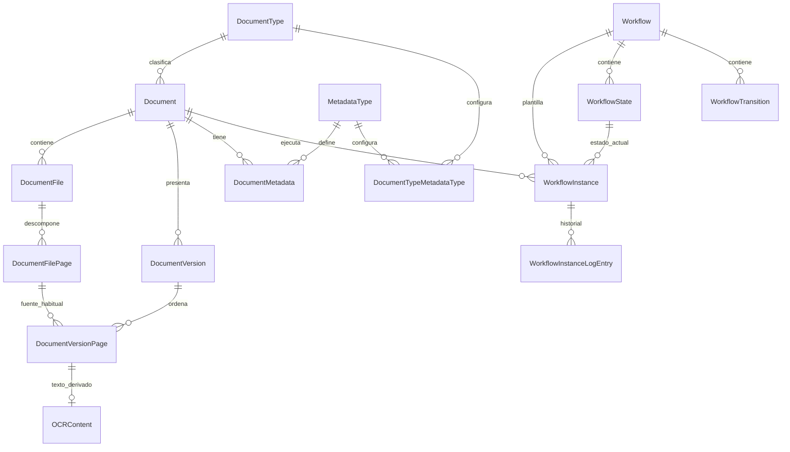
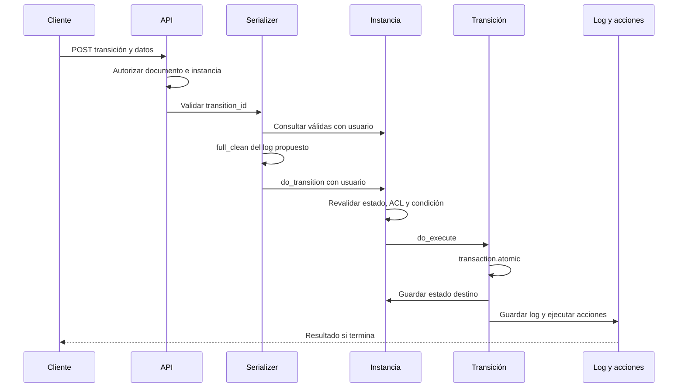
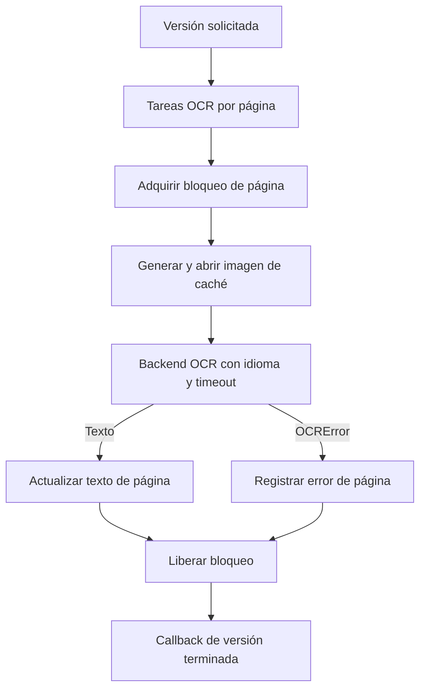

# Mayan EDMS: ingeniería inversa del código público

[Volver al informe principal](00-informe-principal.md).

Fecha de análisis: 16 de octubre de 2026. Referente de repositorio documental, control de acceso, versiones y automatización. Este informe analiza código y ejecuta diez comprobaciones aisladas de métodos reales. **No se levantó Mayan ni se probó su interfaz, API HTTP, base de datos, cola o motor OCR.**

## 1. Resultado que conviene llevar al producto propio

El aporte más valioso de Mayan es separar lo que suele confundirse en un gestor documental: el documento que representa un asunto de negocio, los archivos recibidos, sus páginas originales, las versiones que se muestran y los trabajos derivados como OCR. Su segundo aporte es centralizar la autorización de objetos en una operación que filtra consultas y reutilizarla en listas, detalles y búsquedas. Su tercero es hacer explícitas las plantillas de flujo, sus instancias y el registro de transiciones. Son conclusiones derivadas de los modelos y consumidores examinados, no de una demostración comercial. [Modelos documentales][M01], [ACL][M08], [instancias de flujo][M14].

No copiaría sin revisión tres decisiones observadas: los registros de flujo apuntan a una plantilla mutable; una transacción de base de datos no demuestra exclusión entre dos aprobaciones concurrentes; y un evento de OCR terminado no demuestra que todas sus páginas hayan sido reconocidas correctamente. El detalle y el experimento necesario para resolver cada reserva aparecen más adelante. [Ejecución de transición][M15], [acciones y errores][M17], [procesamiento OCR][M21].

## 2. Qué fuente se inspeccionó

| Dato                              | Evidencia comprobada                                                                               |
| --------------------------------- | -------------------------------------------------------------------------------------------------- |
| Repositorio                       | `https://gitlab.com/mayan-edms/mayan-edms.git`                                                     |
| Rama obtenida                     | `master`, clon superficial de una sola rama                                                        |
| Commit fijado                     | `834ffec1b539171390358e60a0406870108514f5`                                                         |
| Fecha de commit informada por Git | 2026-09-21                                                                                         |
| Versión declarada por el código   | `4.12.2` en `mayan/__init__.py:2`                                                                  |
| Build declarado                   | `v4.12.2-39-g16850d008cb_Wed Sep 16 10:01:41 2026`                                                 |
| Licencia declarada                | GPL versión 2.0 en `LICENSE`; política de marcas separada                                          |
| Copia local                       | `_reference/gestion-documental/mayan-edms/`, ignorada por Git del proyecto REA                     |
| Pruebas de esta investigación     | 67 hashes SHA-256, 66 archivos Python parseados y 10 comprobaciones aisladas; salida del proceso 0 |

Hay una limitación de versión que importa: `git ls-remote --tags --refs` solo anunció `v0.5` y `v1.0`. No se verificó un tag remoto `v4.12.2`; por eso el informe fija el SHA de `master` y no lo llama checkout de ese tag. La documentación oficial describe `master` como producción 4.12.2, pero su revisión publicada (`c6f2ce3b3cd9`) tampoco es el SHA del clon. No se supone identidad binaria con una imagen Docker o paquete PyPI. [Control de fuentes oficial](https://docs.mayan-edms.com/chapters/development/source_control.html), [versión declarada][M00].

La documentación oficial sitúa la publicación 4.12.2 el 14 de septiembre de 2026. Se usó como contexto de versión y no como sustituto del código. [Notas de 4.12.2](https://docs.mayan-edms.com/chapters/releases/4.12.2.html).

La licencia es una observación del archivo del repositorio, no una evaluación jurídica sobre reutilización. Este trabajo entrega modelos explicados, referencias y comprobaciones; no integra el código de Mayan en otro producto. [LICENSE][ML].

## 3. Modelo del dominio reconstruido



El diagrama resume entidades verificadas, pero la relación `DocumentVersionPage → DocumentFilePage` es deliberadamente marcada como fuente habitual: el modelo real usa `GenericForeignKey` con `content_type` y `object_id`, no una FK exclusiva a página de archivo. Los punteros `Document.file_latest` y `Document.version_active` también existen y son distintos. [Documento][M01], [archivo][M02], [página de versión][M04], [OCR][M20].

| Entidad               | Responsabilidad observada                                              | Invariante o detalle útil                                                                                              |
| --------------------- | ---------------------------------------------------------------------- | ---------------------------------------------------------------------------------------------------------------------- |
| `Document`            | Identidad lógica, UUID, tipo, etiqueta, descripción, idioma y papelera | Puede existir como `is_stub` antes de recibir un archivo; tiene punteros separados a archivo reciente y versión activa |
| `DocumentFile`        | Bytes recibidos, nombre, MIME, codificación, tamaño y checksum         | Muchos archivos por documento; `FileField` con almacenamiento configurable                                             |
| `DocumentFilePage`    | Página extraída de un archivo                                          | Permite referenciar páginas de originales distintos sin confundir su identidad                                         |
| `DocumentVersion`     | Una composición de presentación de un documento                        | Puede activarse/desactivarse; tiene sus propias páginas y comentario                                                   |
| `DocumentVersionPage` | Posición de una fuente de contenido en una versión                     | Unicidad `(document_version, page_number)`; referencia genérica a su fuente                                            |
| `DocumentMetadata`    | Valor de un campo de negocio para un documento                         | Unicidad `(document, metadata_type)`; el valor se almacena como texto                                                  |
| `WorkflowInstance`    | Ejecución de una plantilla sobre un documento                          | Unicidad `(document, workflow)`; `state_active` persiste el estado actual                                              |

Estas invariantes proceden de los modelos, no son garantías de almacenamiento inmutable, retención legal o concurrencia. [Documento][M01], [archivo][M02], [versión][M03], [página][M04], [metadato][M12], [instancia][M14].

### Consecuencia práctica

Una factura recibida por correo y su anexo pueden pertenecer al mismo documento lógico; una nueva versión puede presentar otras páginas sin sobreescribir necesariamente los originales. Si el producto propio guarda una sola URL en la fila «documento», no puede representar bien esta distinción. **Propuesta:** conservar identidad lógica, identidad del archivo y composición/versionado como conceptos separados, aunque la primera interfaz solo muestre una versión. Esta propuesta se deriva del modelo, no afirma cómo está implementado el producto propio, que no se inspeccionó.

## 4. Ingreso, originales y versiones: productor y consumidores

La API de documentos puede crear un documento sin archivo. La carga de un archivo sigue otro proceso: `APIDocumentFileListView.perform_create` guarda un `SharedUploadedFile`, envía `task_document_file_upload` con documento, acción, nombre y usuario, y responde `202`. Por tanto, aceptación del pedido y procesamiento terminado son estados diferentes. [API documental][M05], [API de archivos][M06].

En el modelo, `DocumentFile.save` dirige una alta a `_create` y después a `_introspect`, salvo que se indique `skip_introspection`. `_create` actualiza `file_latest`, marca `is_stub=False` y rellena la etiqueta si falta. `_introspect` calcula checksum, MIME/codificación, tamaño y páginas; al completar emite `signal_post_document_file_upload`. El hash real seleccionado es SHA-256. No se interpreta el comentario del campo como una garantía criptográfica de custodia: un hash detecta igualdad/cambio de bytes cuando se compara, no convierte el almacenamiento en inmutable. [Modelo de archivo][M02], [lógica de archivo][M07].

Mayan define tres acciones concretas tras recibir un archivo:

| Acción    | Comportamiento del código                                                                                            |
| --------- | -------------------------------------------------------------------------------------------------------------------- |
| `append`  | Crea una versión activa con las páginas actuales seguidas por las nuevas. Sin versión activa comienza en la página 1 |
| `replace` | Crea una versión activa que utiliza las páginas del archivo nuevo                                                    |
| `keep`    | Conserva la composición actual; la acción no crea una nueva versión                                                  |

Las dos ramas de `append` se ejecutaron en una prueba aislada del método real, con objetos de páginas y persistencia simulados. Se comprobó el orden de las referencias; no la generación de PDF ni la escritura SQL. [Acciones de archivo][M32], [resultado de comprobaciones](evidencias/mayan-evidencia.json).

`pages_remap` reconstruye las referencias de páginas dentro de una transacción y emite una señal de remapeo. La activación desactiva otras versiones del documento y actualiza `Document.version_active`. **Derivación:** cambiar la composición es una operación propia y debe invalidar derivados de esa composición; no equivale a cambiar el archivo recibido. La atomicidad de estas operaciones se leyó, pero no se probó con escritores simultáneos. [Lógica de versiones][M33].

La ruta antigua `APIDocumentUploadView` está marcada como obsoleta; su docstring dirige la captura canónica a acciones de `sources` y anuncia retirada en Mayan 5.0. La API de acciones comprueba que la fuente esté habilitada y restringe por el permiso de cada acción cuando está definido. **Aprendizaje para integración:** no construir una integración nueva únicamente a partir de ejemplos antiguos de carga; fijar versión y contrato de entrada. [API documental][M05], [acciones de fuentes][M34].

### Borrado y retención

`Document.delete` normalmente mueve a papelera; una eliminación posterior o `to_trash=False` recorre archivos y elimina el documento. El borrado del archivo llama al almacenamiento para eliminar bytes y borra caché. **No hay aquí una prueba de WORM, legal hold ni restauración garantizada.** Las transacciones SQL no revierten por sí mismas un borrado externo de bytes; hay que probar fallos parciales de almacenamiento antes de adoptar el patrón. [Borrado documental][M01], [borrado de archivo][M02].

## 5. Permisos: reconstrucción de la decisión, no solo de los roles

La ruta de identidad observada es `usuario → grupo → rol`. Un rol tiene permisos globales y puede recibir permisos sobre objetos mediante ACL. Una ACL identifica el objeto con tipo e ID, enlaza un rol y una colección de permisos, y tiene unicidad por `(content_type, object_id, role)`. No se encontró un campo «denegar» en este modelo. [Modelos de permiso][M09], [modelo ACL][M10].

`AccessControlListManager.restrict_queryset` actúa así:

1. Si el usuario no está autenticado, devuelve consulta vacía.
2. Si tiene el permiso global, devuelve la consulta recibida.
3. Si no, construye filtros ACL para sus grupos/roles y herencias registradas, los combina y restringe la consulta.
4. `check_access` reutiliza esa restricción y comprueba la existencia del objeto solicitado; no implementa otra política independiente.

El permiso global considera tanto `is_superuser` como `is_staff` suficientes. Es una propiedad concreta de este código y no una definición general de Django. Se ejecutaron aisladas las ramas no autenticado, permiso global y combinación OR de filtros; la consulta SQL real y la resolución de grupos/herencia no se ejecutaron. [Gestor ACL][M08], [permiso global][M11].

La herencia es un grafo registrado por la aplicación. Para documentos se registran, entre otras, `Document → document_type`, `DocumentFile → document` y `document__document_type`, `DocumentVersion → document` y `document__document_type`, y `DocumentVersionPage → document_version`. `ModelPermission.register_inheritance` comprueba ciclos para relaciones cuyo modelo puede resolverse. **Aprendizaje:** una ACL local no equivale automáticamente a revocar un permiso global o heredado; el producto debe explicar de dónde llegó el acceso. [Herencia de archivos][M35], [herencia de versiones y páginas][M59], [herencia del documento][M60], [registro y ciclos][M36].

### Matriz de rutas hermanas inspeccionadas

| Superficie                | Punto de autorización observado                                                                            | Alcance de la comprobación                                                                                 |
| ------------------------- | ---------------------------------------------------------------------------------------------------------- | ---------------------------------------------------------------------------------------------------------- |
| Lista de documentos       | `GET → permission_document_view`, `Document.valid.all()` y `MayanObjectPermissionsFilter`                  | Fuente, filtro y clase base leídos                                                                         |
| Detalle del documento     | `GET → document_view`; editar propiedades y papelera tienen permisos propios                               | Misma restricción de queryset en `RetrieveUpdateDestroyAPIView`                                            |
| Lista/detalle de archivos | `document_file_view`; el conjunto se obtiene desde el documento padre                                      | La ruta limita archivos al documento solicitado                                                            |
| Imagen/página de archivo  | `document_file_view` sobre objeto o padre según la vista                                                   | Se leyeron las vistas hermanas y sus mixins                                                                |
| Descarga de original      | `document_file_download` y `get_document().files.all()`                                                    | El backend de descarga obtiene el objeto mediante `get_object`, que pasa por la clase genérica             |
| Enviar a OCR              | `document_version_ocr`, sobre documento o versión según endpoint                                           | Respuesta `202`; no significa OCR correcto                                                                 |
| Leer/editar texto OCR     | `ocr_content_view` o `ocr_content_edit`; `get_document_version_page(permission=...)`                       | No se asumió ausencia de control por sobrescribir `get_object`: sí existe comprobación explícita del padre |
| Búsqueda                  | Permiso del `SearchModel`, consulta reconstruida con IDs y `restrict_queryset`                             | La búsqueda de documentos usa `document_view`; el límite final se aplica después de ACL                    |
| Transición de workflow    | Permiso sobre documento externo, selección de transición válida con usuario y segunda consulta al ejecutar | Se siguieron API, serializer y modelo                                                                      |

Fuentes: [vistas de documentos][M05], [vistas de archivos][M06], [padres][M37], [filtro REST][M38], [genéricas REST][M39], [descarga][M40], [consumidor de descarga][M41], [API OCR][M22], [búsqueda][M23], [API workflow][M18], [serializer workflow][M19]. No se realizaron solicitudes HTTP; esta matriz demuestra puntos de control en fuente, no ausencia de fallos en una instalación.

Hay un matiz relevante para definir permisos del producto propio: el campo OCR se incorpora a la búsqueda del documento y esta búsqueda usa permiso `document_view`; el endpoint de texto OCR usa un permiso específico. No se debe suponer que «no poder abrir OCR» impide todas las inferencias por búsqueda. **Pendiente de prueba funcional:** usuario con permiso de documento y sin permiso OCR, consulta por texto sensible, resultados, extractos y conteos. No se reporta fuga confirmada. [Campos OCR][M42], [modelo de búsqueda documental][M43], [API OCR][M22].

## 6. Metadatos: configuración separada del valor y normalización localizada

`MetadataType` define nombre interno, etiqueta, valor por defecto, lookup, validador/parser y argumentos YAML. `DocumentTypeMetadataType` dice qué campo aplica a qué tipo y si es obligatorio. `DocumentMetadata` almacena un único valor por documento y tipo de campo. Este es un modelo extensible de campos de negocio; no se verificó una representación nativa de líneas de factura, importes tipados o relaciones contables. [Tipo de metadato][M13], [relación de tipo][M44], [valor documental][M12].

El orden real de `MetadataType.validate_value` es:


Se ejecutaron cuatro comprobaciones aisladas sobre ese método: vacío obligatorio rechazado, defecto antes de obligatoriedad, rechazo de opción fuera del lookup y validador antes de parser. **Implicación:** una normalización no repara automáticamente una entrada que ya rechazó el lookup/validador; al diseñar campos como NIT, número de factura o fecha hay que decidir explícitamente el orden. [Validación][M13], [comprobaciones](evidencias/mayan-evidencia.json).

El serializer de metadatos llama a `full_clean` y recoge el valor normalizado tanto al crear como al editar. `DocumentMetadata.save` comprueba que el tipo sea aplicable al tipo documental, pero su propio cuerpo no repite toda la validación del valor; esta vive en `clean_fields`. `delete` impide retirar un campo requerido salvo que se desactive `enforce_required`. **Aprendizaje:** hay que conservar una única autoridad para validar y revisar todos los escritores, incluyendo importaciones y automatizaciones; no basta con validar el formulario. Este informe confirmó el camino API descrito, no auditó todos los escritores del sistema. [Modelo de metadatos][M12], [serializer][M45].

## 7. Workflows: modelo, ejecución y límites reales

### Plantilla e instancia

`Workflow` guarda nombre interno, etiqueta, tipos documentales, autoarranque e `ignore_completed`. `WorkflowState` guarda estado inicial/final y porcentaje de progreso; `WorkflowTransition` enlaza origen y destino, con condición. La instancia se liga a documento y plantilla y mantiene `state_active` y contexto JSON en texto. El log guarda fecha, transición, usuario, comentario y datos adicionales. Solo puede existir una instancia por par documento/plantilla en este modelo. [Plantilla][M46], [estados][M47], [transiciones][M48], [instancia/log][M14].

No se identificó aquí un motor de tokens BPMN ni una tabla de tareas humanas paralelas. El estado activo es una sola FK. **Derivación:** no asumir que este modelo resuelve por sí mismo tres aprobadores simultáneos, quorum, delegación, sustitución o segregación de funciones. Se pueden construir procesos encima, pero cada una de esas reglas requiere diseño y pruebas propias; su existencia no quedó verificada.

### Camino de una transición por API



El listado de transiciones empieza por las transiciones salientes del estado actual. Si hay usuario, restringe por `permission_workflow_instance_transition`; luego evalúa condiciones. `do_transition` vuelve a consultar válidas antes de llamar a `do_execute`. Este último actualiza estado y crea log dentro de `transaction.atomic`. Guardar el log emite evento y dispara acciones de salida y entrada. [API][M18], [serializer][M19], [selección/ejecución][M16], [transacción][M15], [log][M14].

Los disparadores automáticos y las escalaciones pueden llamar sin usuario. En ese caso, `get_queryset_valid_transitions` no aplica el filtro de usuario, aunque conserva estado y condiciones. Es una vía de automatización observada; no se presenta como bypass HTTP demostrado. El gestor de triggers selecciona la primera transición válida y excluye instancias finales cuando `ignore_completed=True`. [Gestor de triggers][M49], [lógica de instancia][M16].

### Reservas que sí cambian un diseño

| Observación en fuente                                                                                                                                   | Qué puede concluirse                                                                              | Qué falta comprobar                                                                                                      |
| ------------------------------------------------------------------------------------------------------------------------------------------------------- | ------------------------------------------------------------------------------------------------- | ------------------------------------------------------------------------------------------------------------------------ |
| Validación de transición fuera de `do_execute`; dentro se guarda destino y log, sin `select_for_update` ni comparación de estado esperado en ese método | La transacción observada no prueba exclusión de dos decisiones concurrentes                       | Dos peticiones sincronizadas contra PostgreSQL, con aprobación/rechazo sobre la misma instancia; revisar logs y acciones |
| Contexto actualizado en `do_context_update` antes de entrar a `do_execute`                                                                              | El contexto y la transición no aparecen encapsulados por una única transacción en ese tramo local | Fallo posterior controlado y estado final de contexto, log y acciones con configuración real                             |
| El log referencia transición; esta referencia estados y plantilla mutables                                                                              | El historial no es un snapshot independiente de la definición                                     | Renombrar/reconfigurar plantilla con instancias terminadas y comprobar representación histórica                          |
| Handlers de predelete de estado/transición recorren y eliminan instancias de la plantilla; están conectados en `apps.py`                                | Eliminar configuración puede eliminar ejecución e historial asociados                             | En base aislada: borrar un estado no activo y una transición; contar instancias/logs antes/después                       |
| `do_queryset_actions_execute` captura error, intenta registrarlo y rompe el bucle; en DEBUG/TESTING vuelve a lanzar                                     | El éxito del cambio de estado no debe equipararse sin más a éxito de todos los efectos            | Error real de backend en modo normal y lectura de estado, log de error y efectos ya ejecutados                           |
| `WorkflowInstanceLogEntry.clean` recorre solo las claves presentes en `extra_data`                                                                      | El método aislado con `{}` no consulta definiciones de campos; se comprobó                        | En API real: omitir un campo marcado requerido; contrastar formulario, serializer y respuesta                            |

Fuentes: [transacción][M15], [contexto][M16], [log][M14], [handlers][M50], [registro de señales][M51], [acciones][M17], [serializer][M19]. Estas son reservas de diseño y casos de aceptación propuestos, no incidentes de producción ni una auditoría de vulnerabilidades.

**Propuesta para un producto que aprueba pagos:** snapshot/versionado de la definición por instancia; transición con estado esperado y exclusión concurrente; clave de idempotencia para cada decisión; validación de campos requeridos en la autoridad de dominio; estado separado para efectos pendientes/fallidos y reintentos. La referencia Mayan permite concretar estos requisitos; no prueba que el producto propio carezca de ellos.

## 8. OCR: texto por página, trabajo asíncrono y semántica de finalización

El resultado OCR es `DocumentVersionPageOCRContent`, relación uno a uno con página de versión y un `TextField` de contenido. La configuración por tipo tiene `auto_ocr`. El modelo no almacena en esos campos cajas, confianza por palabra, NIT, impuestos ni líneas de factura. Por ello este subsistema es referencia de extracción de texto y procesamiento, no evidencia de validación financiera como la que se estudia en Rossum. [Modelos OCR][M20].

La tarea de versión obtiene sus páginas y crea un `chord`: tareas por página más callback de finalización. Con cero páginas también programa finalización. La tarea de página reintenta cuando faltan imágenes de caché, hay error de bloqueo o `OperationalError`. El gestor obtiene bloqueo de página, genera imagen, abre caché, ejecuta backend con idioma, hace `update_or_create` del texto y libera el bloqueo en `finally`. [Tareas OCR][M52], [gestor OCR][M21].



La rama `OCRError` registra el error pero no lo vuelve a lanzar dentro de ese `except`. `do_ocr_finished` emite el evento de versión finalizada y no revisa un conteo de páginas correctas. **Derivación:** la semántica observada de «terminado» permite finalización del procesamiento sin probar éxito total; no hay que usar ese evento como permiso automático para pagar una factura. Un fallo al escribir el log de error u otra excepción puede seguir otra ruta; no se simuló toda la cola. [Gestor OCR][M21], [tareas OCR][M52].

Tesseract se invoca como proceso con entrada/salida estándar, idioma cuando existe, argumentos extra y timeout configurable; los errores se traducen a `OCRError`. El backend se leyó; no se ejecutó Tesseract y no se midió precisión ni velocidad. [Backend Tesseract][M53].

**Propuesta de estados para el producto propio:** recibido, en procesamiento, resultado parcial, requiere validación, validado y error recuperable. Para cada ejecución conservar versión de archivo, versión de configuración, páginas esperadas/procesadas, errores, confianza cuando el proveedor la dé y decisiones humanas. Estos estados son propuesta del informe, no nombres de estados encontrados en Mayan.

## 9. Búsqueda, almacenamiento y auditoría

### Búsqueda como proyección

`SearchModel` define campos y permiso; los documentos usan manager `valid`. OCR añade texto de páginas al modelo documental. La búsqueda resuelve IDs con su backend, reconstruye queryset, aplica el permiso del modelo y después el límite final. Los cambios de objetos/relaciones alimentan tareas de indexación y desindexación a través de señales. **Derivación:** el índice es una proyección que puede demorarse; la autorización de resultados se conserva en una segunda frontera de consulta. No se midió el retraso ni la igualdad entre backends. [Búsqueda][M23], [registro documental][M43], [campos OCR][M42], [handlers de índice][M54].

Los scopes tienen límite propio antes de combinar resultados; el código advierte que, al excederlo, varias operaciones de conjuntos pueden no ser fiables y permite lanzar error según configuración. **Aprendizaje:** un buscador debe informar truncamiento o cobertura incompleta; un conteo limitado no representa necesariamente todos los documentos. [Consultas por scopes][M55].

### Almacenamiento y caché con responsabilidades distintas

Hay `DefinedStorage` independientes para archivos originales, imágenes de páginas de archivo e imágenes de páginas de versión. El backend y argumentos provienen de settings. Esto separa persistencia fuente de artefactos regenerables. No se verificó un backend S3/GCS real, cifrado configurado, retención del bucket, restauración de backup ni rendimiento de caché. [Almacenamientos][M56].

### Evento no equivale a libro inalterable

`EventType.commit` puede publicar una tarea o ejecutar en el proceso según configuración; `_commit` registra acción con actor, objeto y destino y crea notificaciones para suscripciones. Hay funciones explícitas para limpiar y exportar eventos; `task_event_queryset_clear` puede borrar un queryset autorizado. El log de workflow y el sistema general de eventos son mecanismos distintos. **No se verificó sellado criptográfico ni inmutabilidad de auditoría.** [Eventos][M24], [tareas de eventos][M25], [log workflow][M14].

No se deduce «exactamente una vez» de usar Celery. El código tiene deduplicación configurable: el backend nulo despacha directamente; otros backends usan marcadores y `transaction.on_commit`. La tarea de evento está registrada sin backend específico en `events/queues.py`, y `TaskType` toma el nulo cuando no se indica otro, aunque admite override por settings. **Aprendizaje:** comprobar por tipo de tarea deduplicación, publicación tras commit, reintentos y efectos, en vez de atribuir una garantía global a todas las colas. La configuración de una instalación no fue inspeccionada. [Clases de tareas][M26], [backends][M27], [tipos de tarea][M57], [cola de eventos][M58].

## 10. Qué adoptar y qué adaptar

| Prioridad propuesta | Aprendizaje concreto                                                 | Criterio de aceptación para el producto propio                                                                      |
| ------------------- | -------------------------------------------------------------------- | ------------------------------------------------------------------------------------------------------------------- |
| P0                  | Identidad estable del documento separada de sus archivos y versiones | Reemplazar o anexar un archivo conserva originales e historial y permite identificar qué versión fue aprobada       |
| P0                  | Autorización central para consultas y objetos                        | El mismo usuario ve un conjunto coherente en lista, detalle, búsqueda, miniatura, OCR y descarga; probar revocación |
| P0                  | Configuración y ejecución de workflow separadas                      | Cambiar la plantilla no reescribe el significado de aprobaciones anteriores                                         |
| P0                  | Estados y efectos separados                                          | Dos aprobadores concurrentes no producen pagos ni notificaciones duplicadas; el fallo externo queda recuperable     |
| P0                  | OCR parcial no implica documento validado                            | Una página fallida impide cerrar validación sin decisión humana explícita                                           |
| P1                  | Campos configurables con validación reutilizada                      | Formulario, API, importación y automatización rechazan/normalizan igual                                             |
| P1                  | Índices y caché como derivados                                       | Se pueden reconstruir sin perder originales; límites y retrasos son observables                                     |
| P1                  | Auditoría con contrato propio                                        | Se conserva quién, qué versión, qué regla y qué resultado; borrado/retención se definen aparte                      |

Las prioridades son juicio de diseño para una aplicación documental que procesa aprobaciones y facturas; no son un ranking medido ni una descripción de necesidades verificadas del producto del usuario.

## 11. Paquete de evidencia y reproducción

Archivos entregados:

- [`evidencias/verificar-mayan.py`](evidencias/verificar-mayan.py): comprueba SHA y árbol tracked limpio, parsea los archivos seleccionados, extrae métodos concretos y ejecuta diez casos con colaboradores simulados.
- [`evidencias/mayan-evidencia.json`](evidencias/mayan-evidencia.json): hashes de 67 archivos, símbolos con líneas, URL al SHA y resultados de los casos. No incluye secretos, entorno completo ni copia del repositorio.

Reproducción desde la raíz de REA, con Python 3 y Git ya disponibles y la copia de referencia presente:

```sh
python3 documentos/2026-10-16-gestion-documental/evidencias/verificar-mayan.py _reference/gestion-documental/mayan-edms --output documentos/2026-10-16-gestion-documental/evidencias/mayan-evidencia.json
```

Resultado obtenido, proceso terminado con código 0:

```text
files_hashed: 67
python_files_parsed: 66
isolated_checks_passed: 10
```

Los diez casos son: requerido vacío, defecto previo, opción de lookup inválida, orden validador/parser, usuario anónimo, permiso global, combinación OR de filtros locales, append sin versión, append con versión y recorrido vacío de datos adicionales en validación de log. Se ejecuta el cuerpo extraído del código fijado, sin importar los módulos del proyecto. La base de datos, framework, traducción, consultas y persistencia se sustituyen donde corresponde. **Eso prueba semántica local de las ramas elegidas; no equivale a probar Django ni Mayan instalado.**

Para recuperar la fuente en otro computador: clonar el repositorio oficial y hacer checkout del SHA indicado. El clon de referencia se excluye de Git del proyecto. Si ese commit dejara de estar disponible remotamente, el JSON todavía permite contrastar contenido de archivos obtenidos por otra vía, pero no lo reemplaza. No se descargaron Docker images ni se instaló Mayan.

## 12. Siguiente validación, definida para ejecutar sin improvisar

Estos experimentos no se realizaron. Requieren instancia aislada de Mayan con base, cola, OCR y dos sesiones de prueba; datos ficticios y receptores simulados, sin correos ni llamadas externas reales.

| Caso                    | Preparación                                                                                    | Acción y evidencia mínima                                                                                            |
| ----------------------- | ---------------------------------------------------------------------------------------------- | -------------------------------------------------------------------------------------------------------------------- |
| ACL consistente         | Dos usuarios no privilegiados, grupos/roles distintos, un documento visible y otro restringido | Comparar IDs y conteos en lista, detalle, búsqueda, archivo, imagen, OCR y descarga; repetir tras revocar permiso    |
| Permiso heredado        | Otorgar permiso en tipo, retirarlo localmente en documento                                     | Comprobar acceso efectivo y explicación de origen; distinguir revocar concesión de denegación                        |
| Versión aprobada        | Original de dos páginas y anexo de una                                                         | Append, replace y keep; verificar hashes originales, referencias de páginas y versión que usa el flujo               |
| OCR parcial             | Tres páginas, backend simulado falla exactamente en la segunda                                 | Registrar resultado por página, callback, eventos, texto previo y reintento; no usar OCR real para simular fallo     |
| Dos decisiones          | Instancia en revisión con aprobar/rechazar válidos                                             | Barrera de sincronización en dos requests; una decisión final coherente, conteo de logs y efectos externos simulados |
| Configuración histórica | Flujo completado con comentario y datos                                                        | Renombrar y luego eliminar transición/estado en copia desechable; medir conservación de instancia y log              |
| Campos requeridos       | Transición con campo requerido                                                                 | Formulario/API con campo omitido, vacío y válido; comparar respuesta, contexto y log                                 |
| Error de efecto         | Acción de salida o entrada que falla con un receptor local simulado                            | Verificar estado, log, error, efectos previos y posibilidad de reintento idempotente                                 |
| Búsqueda limitada       | Conjunto sintético que supera límite configurado                                               | Comparar consulta simple y scopes; registrar truncamiento/error y conteo total conocido                              |
| Recuperación            | Snapshot de datos de prueba y almacenamiento                                                   | Restaurar, reconstruir índices/cachés y verificar hashes y relaciones completas                                      |

La investigación de fuente y los casos aislados están guardados. Falta esta validación integrada para convertir reservas en comportamiento observado de una instalación.

## Referencias a código fijado

Los enlaces siguientes apuntan todos al SHA indicado, no a una rama móvil. Las líneas y hashes completos se conservan en el JSON de evidencia.

[M00]: https://gitlab.com/mayan-edms/mayan-edms/-/blob/834ffec1b539171390358e60a0406870108514f5/mayan/__init__.py#L1-17
[ML]: https://gitlab.com/mayan-edms/mayan-edms/-/blob/834ffec1b539171390358e60a0406870108514f5/LICENSE
[M01]: https://gitlab.com/mayan-edms/mayan-edms/-/blob/834ffec1b539171390358e60a0406870108514f5/mayan/apps/documents/models/document_models.py#L26-162
[M02]: https://gitlab.com/mayan-edms/mayan-edms/-/blob/834ffec1b539171390358e60a0406870108514f5/mayan/apps/documents/models/document_file_models.py#L30-171
[M03]: https://gitlab.com/mayan-edms/mayan-edms/-/blob/834ffec1b539171390358e60a0406870108514f5/mayan/apps/documents/models/document_version_models.py#L23-109
[M04]: https://gitlab.com/mayan-edms/mayan-edms/-/blob/834ffec1b539171390358e60a0406870108514f5/mayan/apps/documents/models/document_version_page_models.py#L28-97
[M05]: https://gitlab.com/mayan-edms/mayan-edms/-/blob/834ffec1b539171390358e60a0406870108514f5/mayan/apps/documents/api_views/document_api_views.py#L28-165
[M06]: https://gitlab.com/mayan-edms/mayan-edms/-/blob/834ffec1b539171390358e60a0406870108514f5/mayan/apps/documents/api_views/document_file_api_views.py#L22-138
[M07]: https://gitlab.com/mayan-edms/mayan-edms/-/blob/834ffec1b539171390358e60a0406870108514f5/mayan/apps/documents/models/document_file_model_mixins.py#L36-258
[M08]: https://gitlab.com/mayan-edms/mayan-edms/-/blob/834ffec1b539171390358e60a0406870108514f5/mayan/apps/acls/managers.py#L227-275
[M09]: https://gitlab.com/mayan-edms/mayan-edms/-/blob/834ffec1b539171390358e60a0406870108514f5/mayan/apps/permissions/models.py#L17-88
[M10]: https://gitlab.com/mayan-edms/mayan-edms/-/blob/834ffec1b539171390358e60a0406870108514f5/mayan/apps/acls/models.py#L22-93
[M11]: https://gitlab.com/mayan-edms/mayan-edms/-/blob/834ffec1b539171390358e60a0406870108514f5/mayan/apps/permissions/model_mixins.py#L81-124
[M12]: https://gitlab.com/mayan-edms/mayan-edms/-/blob/834ffec1b539171390358e60a0406870108514f5/mayan/apps/metadata/models/metadata_instance_models.py#L21-111
[M13]: https://gitlab.com/mayan-edms/mayan-edms/-/blob/834ffec1b539171390358e60a0406870108514f5/mayan/apps/metadata/models/metadata_type_models.py#L17-144
[M14]: https://gitlab.com/mayan-edms/mayan-edms/-/blob/834ffec1b539171390358e60a0406870108514f5/mayan/apps/document_states/models/workflow_instance_models.py#L28-177
[M15]: https://gitlab.com/mayan-edms/mayan-edms/-/blob/834ffec1b539171390358e60a0406870108514f5/mayan/apps/document_states/models/workflow_transition_model_mixins.py#L38-56
[M16]: https://gitlab.com/mayan-edms/mayan-edms/-/blob/834ffec1b539171390358e60a0406870108514f5/mayan/apps/document_states/models/workflow_instance_model_mixins.py#L16-123
[M17]: https://gitlab.com/mayan-edms/mayan-edms/-/blob/834ffec1b539171390358e60a0406870108514f5/mayan/apps/document_states/models/workflow_state_model_mixins.py#L19-58
[M18]: https://gitlab.com/mayan-edms/mayan-edms/-/blob/834ffec1b539171390358e60a0406870108514f5/mayan/apps/document_states/api_views/workflow_instance_api_views.py#L107-179
[M19]: https://gitlab.com/mayan-edms/mayan-edms/-/blob/834ffec1b539171390358e60a0406870108514f5/mayan/apps/document_states/serializers/workflow_instance_serializers.py#L41-140
[M20]: https://gitlab.com/mayan-edms/mayan-edms/-/blob/834ffec1b539171390358e60a0406870108514f5/mayan/apps/ocr/models.py#L20-71
[M21]: https://gitlab.com/mayan-edms/mayan-edms/-/blob/834ffec1b539171390358e60a0406870108514f5/mayan/apps/ocr/managers.py#L21-105
[M22]: https://gitlab.com/mayan-edms/mayan-edms/-/blob/834ffec1b539171390358e60a0406870108514f5/mayan/apps/ocr/api_views.py#L25-119
[M23]: https://gitlab.com/mayan-edms/mayan-edms/-/blob/834ffec1b539171390358e60a0406870108514f5/mayan/apps/dynamic_search/search_backends.py#L426-466
[M24]: https://gitlab.com/mayan-edms/mayan-edms/-/blob/834ffec1b539171390358e60a0406870108514f5/mayan/apps/events/classes.py#L375-482
[M25]: https://gitlab.com/mayan-edms/mayan-edms/-/blob/834ffec1b539171390358e60a0406870108514f5/mayan/apps/events/tasks.py#L15-113
[M26]: https://gitlab.com/mayan-edms/mayan-edms/-/blob/834ffec1b539171390358e60a0406870108514f5/mayan/apps/task_manager/task_classes.py#L10-88
[M27]: https://gitlab.com/mayan-edms/mayan-edms/-/blob/834ffec1b539171390358e60a0406870108514f5/mayan/apps/task_manager/task_deduplication_backends.py#L57-191
[M32]: https://gitlab.com/mayan-edms/mayan-edms/-/blob/834ffec1b539171390358e60a0406870108514f5/mayan/apps/documents/document_file_actions.py#L7-87
[M33]: https://gitlab.com/mayan-edms/mayan-edms/-/blob/834ffec1b539171390358e60a0406870108514f5/mayan/apps/documents/models/document_version_model_mixins.py#L52-338
[M34]: https://gitlab.com/mayan-edms/mayan-edms/-/blob/834ffec1b539171390358e60a0406870108514f5/mayan/apps/sources/api_views/source_action_api_views.py#L33-134
[M35]: https://gitlab.com/mayan-edms/mayan-edms/-/blob/834ffec1b539171390358e60a0406870108514f5/mayan/apps/documents/apps.py#L267-275
[M36]: https://gitlab.com/mayan-edms/mayan-edms/-/blob/834ffec1b539171390358e60a0406870108514f5/mayan/apps/acls/classes.py#L18-271
[M37]: https://gitlab.com/mayan-edms/mayan-edms/-/blob/834ffec1b539171390358e60a0406870108514f5/mayan/apps/documents/api_views/api_view_mixins.py#L9-137
[M38]: https://gitlab.com/mayan-edms/mayan-edms/-/blob/834ffec1b539171390358e60a0406870108514f5/mayan/apps/rest_api/filters.py#L7-36
[M39]: https://gitlab.com/mayan-edms/mayan-edms/-/blob/834ffec1b539171390358e60a0406870108514f5/mayan/apps/rest_api/generics.py#L19-161
[M40]: https://gitlab.com/mayan-edms/mayan-edms/-/blob/834ffec1b539171390358e60a0406870108514f5/mayan/apps/document_downloads/api_views.py#L15-41
[M41]: https://gitlab.com/mayan-edms/mayan-edms/-/blob/834ffec1b539171390358e60a0406870108514f5/mayan/apps/storage/views/mixins.py#L10-144
[M42]: https://gitlab.com/mayan-edms/mayan-edms/-/blob/834ffec1b539171390358e60a0406870108514f5/mayan/apps/ocr/search.py#L9-22
[M43]: https://gitlab.com/mayan-edms/mayan-edms/-/blob/834ffec1b539171390358e60a0406870108514f5/mayan/apps/documents/search.py#L12-177
[M44]: https://gitlab.com/mayan-edms/mayan-edms/-/blob/834ffec1b539171390358e60a0406870108514f5/mayan/apps/metadata/models/document_type_metadata_type_models.py#L17-66
[M45]: https://gitlab.com/mayan-edms/mayan-edms/-/blob/834ffec1b539171390358e60a0406870108514f5/mayan/apps/metadata/serializers.py#L129-193
[M46]: https://gitlab.com/mayan-edms/mayan-edms/-/blob/834ffec1b539171390358e60a0406870108514f5/mayan/apps/document_states/models/workflow_models.py#L23-87
[M47]: https://gitlab.com/mayan-edms/mayan-edms/-/blob/834ffec1b539171390358e60a0406870108514f5/mayan/apps/document_states/models/workflow_state_models.py#L21-99
[M48]: https://gitlab.com/mayan-edms/mayan-edms/-/blob/834ffec1b539171390358e60a0406870108514f5/mayan/apps/document_states/models/workflow_transition_models.py#L23-88
[M49]: https://gitlab.com/mayan-edms/mayan-edms/-/blob/834ffec1b539171390358e60a0406870108514f5/mayan/apps/document_states/managers.py#L26-98
[M50]: https://gitlab.com/mayan-edms/mayan-edms/-/blob/834ffec1b539171390358e60a0406870108514f5/mayan/apps/document_states/handlers.py#L68-107
[M51]: https://gitlab.com/mayan-edms/mayan-edms/-/blob/834ffec1b539171390358e60a0406870108514f5/mayan/apps/document_states/apps.py#L821-868
[M52]: https://gitlab.com/mayan-edms/mayan-edms/-/blob/834ffec1b539171390358e60a0406870108514f5/mayan/apps/ocr/tasks.py#L15-130
[M53]: https://gitlab.com/mayan-edms/mayan-edms/-/blob/834ffec1b539171390358e60a0406870108514f5/mayan/apps/ocr/backends/tesseract.py#L16-128
[M54]: https://gitlab.com/mayan-edms/mayan-edms/-/blob/834ffec1b539171390358e60a0406870108514f5/mayan/apps/dynamic_search/handlers.py#L12-152
[M55]: https://gitlab.com/mayan-edms/mayan-edms/-/blob/834ffec1b539171390358e60a0406870108514f5/mayan/apps/dynamic_search/scoped_queries.py#L325-378
[M56]: https://gitlab.com/mayan-edms/mayan-edms/-/blob/834ffec1b539171390358e60a0406870108514f5/mayan/apps/documents/storages.py#L20-59
[M57]: https://gitlab.com/mayan-edms/mayan-edms/-/blob/834ffec1b539171390358e60a0406870108514f5/mayan/apps/task_manager/classes.py#L43-76
[M58]: https://gitlab.com/mayan-edms/mayan-edms/-/blob/834ffec1b539171390358e60a0406870108514f5/mayan/apps/events/queues.py#L19-23
[M59]: https://gitlab.com/mayan-edms/mayan-edms/-/blob/834ffec1b539171390358e60a0406870108514f5/mayan/apps/documents/apps.py#L693-703
[M60]: https://gitlab.com/mayan-edms/mayan-edms/-/blob/834ffec1b539171390358e60a0406870108514f5/mayan/apps/documents/apps.py#L906-908
