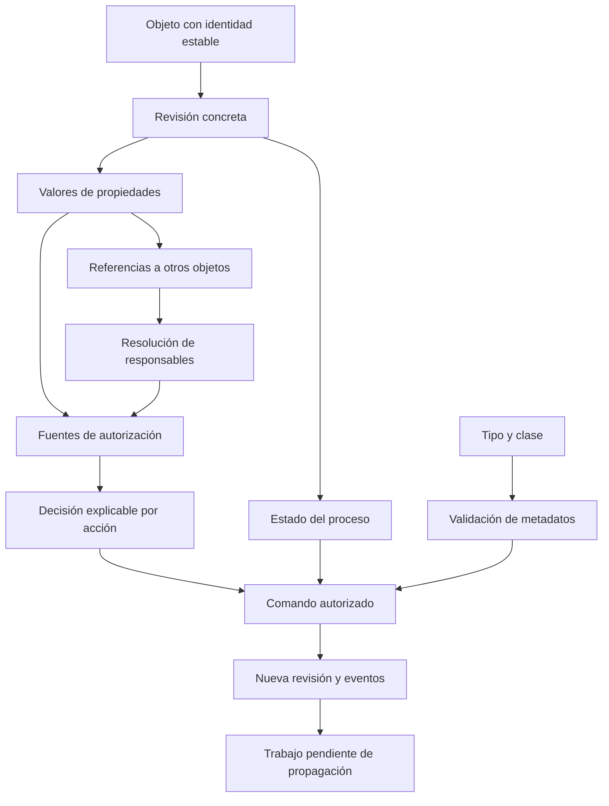

# M-Files: relaciones, permisos y ciclo de vida documental

[Volver al informe principal](00-informe-principal.md).

Fecha de investigación: 16 de octubre de 2026. Alcance: documentación pública oficial, páginas completas y contratos públicos de API. **No se ejecutó M-Files, no se accedió a una bóveda autenticada y no se inspeccionaron binarios ni código interno del fabricante.** Este es un análisis de comportamiento documentado y reconstrucción conceptual; no es una reproducción experimental del producto.

## 1. Qué aporta al benchmark

La lección más útil es diseñar el documento dentro de un contexto de negocio: cliente, proyecto, responsable y clase documental. La segunda es explicar de dónde sale cada permiso. La tercera es separar la edición actual de las versiones que ya fueron aprobadas.

En las secciones siguientes, **D** significa comportamiento documentado por el fabricante; **I**, inferencia o propuesta propia; **N**, punto no verificado. No se asignan puntuaciones de rendimiento, facilidad de uso o precisión: no se midieron.

Prioridad recomendada para el producto propio, como juicio de diseño: primero referencias estables y clases con metadatos; después permisos explicables y versionados; finalmente propagación dinámica, sustituciones y automatizaciones. La complejidad de los dos últimos grupos exige pruebas expresas de revocación y concurrencia.

## 2. Modelo expuesto: qué es cada cosa

**D — Estructura configurable.** Un tipo de objeto define familias como documento, cliente o proyecto; cada tipo tiene clases. Una clase distingue, por ejemplo, contrato de factura y determina propiedades solicitadas y obligatorias. La definición de propiedad describe su comportamiento; el valor pertenece a una versión concreta. Las selecciones pueden apuntar a valores o a objetos, individualmente o en conjunto. El fabricante recomienda almacenar documentos en el tipo incorporado Documents. [M01]

| Concepto                | Lectura útil para reconstrucción, sin atribuir tablas internas |
| ----------------------- | -------------------------------------------------------------- |
| Tipo                    | Familia de entidad que puede existir en la bóveda.             |
| Clase                   | Especificación de un caso documental dentro del tipo.          |
| Definición de propiedad | Contrato del dato: identidad, tipo y reglas.                   |
| Valor de propiedad      | Dato concreto de una versión del objeto.                       |
| Referencia              | Relación con otra entidad, distinta de su nombre mostrado.     |

**I — Consecuencia.** Una factura debería referenciar un proveedor y un proyecto identificables. Repetir nombres como texto puede servir para presentación, pero no debe ser la única forma de enlazar entidades. Cambiar el nombre de un proveedor no debería obligar a reenlazar cada factura. Es una propuesta para el producto propio, no una afirmación sobre el almacenamiento físico de M-Files.

### Identidad y versiones

**D.** `ObjID` combina tipo e identificador dentro de la bóveda; `ObjVer` añade versión. Al modificar archivos o metadatos se generan versiones; los movimientos por workflow también pueden generarlas. La edición sigue checkout → modificación → checkin; un objeto solo puede estar reservado por una persona a la vez. Algunas operaciones breves gestionan ese ciclo de forma transparente. El historial disponible depende del usuario: no es válido asumir que todos los números de versión siguen presentes o son visibles. [M02]

**I.** Una integración debe conservar por separado el identificador estable, la versión observada y la versión sobre la que pretende escribir. Un nombre o la palabra `latest` no sustituyen una prueba de identidad y frescura. Para un índice que abarque varias bóvedas, añadir la identidad de la bóveda al identificador local es una decisión de diseño razonable.

## 3. Relaciones: grafo de referencias, no copias

**D.** Relacionar objetos no duplica su contenido: los objetos conservan historiales independientes. La tarjeta de metadatos y el diálogo de relaciones muestran conexiones entre los mismos objetos. Esto permite vincular un documento con un cliente o agrupar documentos relacionados sin convertirlos en un único archivo. [M03]

**D.** La consulta REST de relaciones distingue dirección: `from` considera referencias del objeto actual; `to`, referencias que otros objetos dirigen hacia él; `both` es el valor predeterminado. Puede filtrar por tipo de objeto. [M04]

**D.** Las búsquedas indirectas pueden usar una propiedad del objeto relacionado, como `Customer.Country`; la guía describe criterios de hasta tres niveles mediante condiciones adicionales. También permite vistas indirectas. El comportamiento de algunos filtros depende del motor de búsqueda. [M05]

**D.** Entre bóvedas se crean accesos directos con permisos propios; no se exporta automáticamente el objeto original. El acceso directo puede mostrar parte de sus metadatos y enlazar a la bóveda de origen. Renombrarlo no renombra el objeto original. La correspondencia entre definiciones de metadatos interviene en estas relaciones. [M06]

**I — Qué aprovechar.** Mantener una relación canónica con origen, propiedad y destino; producir la navegación inversa a partir de ella. Si la aplicación necesita consultar «todas las facturas de proyectos de este cliente», debe definir el recorrido y los permisos que aplican en cada tramo. No convertir una relación navegable en concesión automática de acceso.

**N.** No se verificó cómo se resuelven referencias a objetos eliminados, qué metadatos de un destino inaccesible se muestran en cada cliente, ni las garantías de consistencia de los accesos directos entre bóvedas.

## 4. Permisos: reglas que conviene separar

### 4.1 Contenido, estructura y acciones son planos distintos

**D.** Los permisos del objeto distinguen lectura, edición, borrado y cambio de permisos. Borrar no equivale a destruir. Sin lectura el documento no aparece en vistas ni resultados de búsqueda. La denegación explícita prevalece frente a una concesión, incluida la obtenida por un grupo. Quien puede cambiar permisos puede concederse otros derechos. El diálogo muestra fuente, descripción y activación de los permisos aplicados. [M07]

**D.** Los permisos de un tipo de objeto controlan ver su nombre y crear objetos de ese tipo. Ocultar el nombre del tipo no impide necesariamente ver objetos existentes en búsquedas o vistas. [M08]

**D.** Una NACL es una lista reutilizable de sujetos y operaciones permitidas o denegadas; admite usuarios, grupos y pseudo-usuarios. El fabricante recomienda grupos y advierte que modificar listas en bóvedas grandes puede ser lento y generar conflictos de bloqueo. [M09]

**I.** Deben existir pruebas distintas para: ver una categoría, crear un documento, leerlo, editarlo, aprobarlo, cambiar sus permisos y administrar la configuración. No demostrar una de esas facultades dando por demostradas las demás.

### 4.2 Intersección restrictiva, con alcance explícito

**D.** Para permisos automáticos extendidos restrictivos, cada derecho debe estar permitido por todas las fuentes activas que lo afectan. Una concesión amplia en el documento puede quedar restringida por su clase o por una propiedad. La guía permite consultar el resultado por usuario y derecho. [M10]

**I — Ejemplo didáctico calculado, no prueba ejecutada.** Suponiendo fuentes exclusivamente restrictivas y sin privilegios administrativos ni excepciones:

| Fuente                     | Leer | Editar |
| -------------------------- | ---: | -----: |
| Documento                  |   Sí |     Sí |
| Proyecto                   |   Sí |     No |
| Clasificación              |   Sí |     Sí |
| Resultado por intersección |   Sí |     No |

No basta con que «alguna fuente permita». El origen que impide una acción debe poder explicarse sin pedir al usuario que interprete todas las listas manualmente.

**D — Límite que evita una falsa simplificación.** El contrato público gRPC `AccessControlList` también expone componentes automáticos aditivos, componentes restrictivos, ACL secundaria de la última versión, una indicación para ignorarla y derechos asociados al checkout. Por ello, el ejemplo anterior no pretende ser el algoritmo universal de toda ACL del producto. **N:** no se verificó la precedencia completa de componentes aditivos con denegaciones, administración y checkout. [M11]

### 4.3 Activación, prioridad y herencia

**D.** Los permisos automáticos pueden proceder de valores, objetos o clases. Para que un valor los aporte debe usarse mediante la propiedad habilitada expresamente para ello. La configuración específica del valor tiene prioridad sobre la del tipo o lista. Puede permitirse desactivar una restricción. Una fuente que no concede nada puede restringir todos los derechos. La documentación indica que los permisos automáticos **no se heredan indirectamente**: que A reciba restricciones de B no significa que C las reciba por referenciar A. [M12]

**I.** Conviene representar como decisiones separadas «relacionar», «usar como fuente de permisos» y «permitir desactivar esa fuente». Una regla de seguridad implícita al crear cualquier relación haría difícil comprender el efecto de editar metadatos.

### 4.4 Pseudo-usuarios y propagación

**D.** Un pseudo-usuario obtiene sujetos desde propiedades basadas en listas de usuarios o grupos. Puede recorrer varios niveles, por ejemplo el responsable del proyecto relacionado. Se puede usar en ACL y workflows. Cambiar al responsable modifica los permisos asociados mediante una tarea asíncrona; la guía permite observar su progreso en Background Tasks. La actualización también puede activarse por cambios de NACL, usuarios o grupos. [M13]

No hay contradicción con 4.3: una cosa es resolver quién ocupa un cargo mediante relaciones y otra propagar una ACL restrictiva de forma transitiva.

**D.** Al editar una NACL se puede elegir aplicar sus cambios a objetos existentes o conservar sus permisos y aplicar la nueva definición solo a objetos nuevos. La actualización de objetos es asíncrona. [M14]

**I.** El producto propio debería distinguir «regla guardada», «actualización en curso» y «permisos aplicados», con seguimiento de fallos. Para una revocación urgente, habría que diseñar expresamente qué ocurre durante la propagación. **N:** no se midieron latencia ni ventana de revocación en M-Files.

### 4.5 Versiones históricas y publicación

**D.** Normalmente, leer una versión antigua requiere lectura de esa versión y de la última registrada. Un estado del workflow puede permitir conservar acceso a determinadas versiones históricas aunque la última sea privada. El cambio de esta opción solo se aplica cuando el objeto entra al estado: editar la configuración o generar otra versión permaneciendo allí no basta. La guía también condiciona su visibilidad en búsqueda a consultar metadatos de todas las versiones. Otra acción del estado permite prescindir de permisos automáticos. [M15]

**I.** Este patrón sirve para un procedimiento aprobado que debe continuar visible mientras se redacta la revisión siguiente. Deben diferenciarse versión actual, versión accesible y versión publicada; pueden coincidir o no. No presentar «la última» como sinónimo de «la aprobada».

### 4.6 Búsqueda y seguridad no son comprobaciones equivalentes

**D.** Para OpenText IDOL y Smart Search, la guía advierte que más de cuatro fuentes ACL automáticas hacen que solo administradores vean el objeto en resultados. Es una limitación documentada de esas combinaciones, no una medida realizada aquí ni una regla general de todos los motores. [M12]

**D.** Buscar por una NACL que emplea pseudo-usuarios puede devolver resultados inexactos o vacíos. [M16]

**I.** Que algo no aparezca en una consulta de auditoría no prueba que sea inaccesible. Un ensayo de permisos debe comparar listado, acceso directo, descarga y consulta API bajo el mismo usuario.

## 5. Workflows: quién actúa, bajo qué condiciones y sobre qué versión

**D.** Los estados admiten precondiciones de entrada y postcondiciones de salida: un documento puede requerir un aprobador antes de entrar en Aprobado o un centro de costo antes de salir de un estado de clasificación. Las reglas pueden extenderse con aplicaciones o scripts; la guía recomienda VAF para desarrollos nuevos o modificados. [M17]

**D.** Una transición tiene sus propios permisos. Puede permitir actuar al responsable obtenido desde metadatos o al usuario de una transición anterior, por ejemplo quien aprobó originalmente. [M18]

**D.** Las transiciones automáticas las ejecuta el servidor y omiten permisos de usuario; los disparadores pueden depender del tiempo, asignaciones o condiciones. La documentación indica evaluación cada 60 minutos y cuando cambia el objeto: cumplir el plazo no promete transición en ese instante. Las transiciones paralelas tienen prioridad de evaluación numérica. [M19]

**D.** «Transiciones paralelas» también puede significar varias flechas entre los mismos estados con criterios diferentes. No demuestra por sí solo una ejecución BPMN con bifurcación y reunión de ramas. La guía muestra una salida manual y otra por vencimiento hacia el mismo destino. [M20]

**D.** Un sustituto puede atender asignaciones, pero para editar el documento asociado necesita sus propios derechos de edición y licencia aplicable. La asignación y el documento no tienen por qué compartir permisos. [M21]

**I — Lección.** El motor propio debe registrar si actuó una persona, una sustitución autorizada o el servidor. La validación del dato, la autoridad para transicionar y la condición automática son contratos independientes. Un temporizador necesita semántica de vencimiento y reintento, no solo un campo «días».

## 6. API y trazabilidad: lo que una integración debe respetar

| Hecho documentado                                                                                                                                                                                                | Implicación para el análisis                                                                                                                           |
| ---------------------------------------------------------------------------------------------------------------------------------------------------------------------------------------------------------------- | ------------------------------------------------------------------------------------------------------------------------------------------------------ |
| MFWS se publica como parte de Classic Web, debe configurarse y puede faltar en una instalación. Soporta operaciones de usuario; no administración nativa general. [M22]                                          | Una URL de producto no demuestra una API disponible. Inventariar instalación y capacidades antes de escribir conectores.                               |
| En propiedades, `POST` añade valores concretos; `PUT` requiere el conjunto completo, pues elimina propiedades omitidas. Actualizar requiere checkout/checkin salvo operación que lo gestione expresamente. [M23] | Un conector que confunde reemplazo con actualización parcial puede perder metadatos.                                                                   |
| Se pueden resolver alias de elementos estructurales a ID; el contrato devuelve `-1` si no resuelve. La página exige servidor 12.0.6783.0 o superior. [M24]                                                       | No fijar IDs de una bóveda como si fueran universales ni tratar ausencia como ID válido.                                                               |
| El recurso de estado permite `GET` y `PUT`, y la documentación menciona un `401` si el objeto tiene título automático. [M25]                                                                                     | Ese comportamiento particular necesita contraste en la versión de laboratorio; no reinterpretar automáticamente todo `401` como credenciales erróneas. |
| La consulta de una versión puede incluir propiedades. El borrado de ese recurso distingue deshacer checkout de destruir todo el objeto mediante `allVersions`. [M26]                                             | Una integración debe separar eliminación lógica, descarte de edición y destrucción definitiva.                                                         |

**D — Auditoría de automatizaciones.** El fabricante documenta que un script durante el guardado puede sustituir el autor visible por M-Files Server. Describe cómo restaurar atribución y aclara que una transición realmente automática conserva autoría del servidor. [M27]

**I.** Para una reconstrucción conviene conservar actor iniciador, ejecutor técnico, razón, versión previa/resultante y correlación de operación. El historial de versiones, por sí solo, no prueba inmutabilidad del registro ni cumplimiento normativo. **N:** no se verificaron retención, firma, no repudio ni protección del registro frente a administradores.

## 7. Reconstrucción conceptual propuesta

Este esquema es **una propuesta propia**, no el esquema SQL, arquitectura interna o código de M-Files. Resume responsabilidades que conviene separar al aprovechar los aprendizajes:

Las decisiones pendientes del producto propio son concretas:

1. **Relaciones.** Definir cardinalidad, dirección, versión referenciada y qué ocurre si el destino desaparece o deja de ser accesible.
2. **Autorización.** Elegir composición de políticas, privilegios administrativos, tratamiento de falta de datos y posibilidad de excepciones. La resolución de responsables no debe inventar un sujeto cuando una propiedad está vacía.
3. **Publicación.** Establecer si un lector ve el aprobado anterior durante una revisión y cómo se revoca una publicación histórica.
4. **Concurrencia.** Decidir entre reserva exclusiva y control de revisión esperada según cada operación; probar que editar metadatos no sobrescribe una decisión de aprobación reciente.
5. **Configuración.** Separar la nueva definición de una regla de su aplicación a documentos existentes. Mostrar alcance e impacto antes de aplicarla.
6. **Propagación.** Definir objetivo, progreso, fallo, reintento y criterio de finalización. Para revocaciones, decidir si el acceso se recalcula sincrónicamente o se suspende mientras la actualización concluye.
7. **Evidencia.** Poder responder «quién pudo acceder a esta versión, por qué y con qué configuración», sin reconstruirlo solo desde la regla actual.

Estas decisiones no autorizan implementación ni cambios a REA. Sirven como criterios para comparar después el producto documental del usuario cuando su código y configuración se incorporen al estudio.

## 8. Protocolo de pruebas pendiente de ejecución

**Todas las pruebas de esta sección están diseñadas, pero no ejecutadas.** Requieren una bóveda de laboratorio autorizada, versión de servidor y cliente registradas, motor de búsqueda identificado, usuarios de prueba aislados y envíos desactivados. Los nombres siguientes son ficticios: creador, responsable A, responsable B, lector y administrador. Nunca usar datos de personas reales para probar asignaciones.

| ID    | Preparación y acción                                                                           | Resultado esperado o pregunta a resolver                                                          | Evidencia a conservar                                          |
| ----- | ---------------------------------------------------------------------------------------------- | ------------------------------------------------------------------------------------------------- | -------------------------------------------------------------- |
| MF-01 | Crear dos clases con requisitos distintos; omitir el campo obligatorio por cliente y API.      | Contrastar validación efectiva por ambas vías. [M01]                                              | Definición, solicitud, error y ausencia/presencia del objeto.  |
| MF-02 | Relacionar documento → proyecto; consultar `from`, `to` y `both`.                              | Verificar orientación y que no se crea una copia documental. [M03], [M04]                         | Identidades, relaciones y versiones antes/después.             |
| MF-03 | Cambiar un dato del cliente; buscar documentos por proyecto/cliente sin copiarlo al documento. | Medir actualización de la búsqueda indirecta y límites de recorrido. [M05]                        | Consulta, usuario, motor, resultados y tiempos.                |
| MF-04 | Permitir edición por grupo y denegarla al usuario de prueba.                                   | La denegación debe prevalecer en cliente y API. [M07]                                             | Fuentes activas, resultado efectivo y respuesta al intento.    |
| MF-05 | Combinar tres fuentes restrictivas con lectura común y edición no común.                       | Contrastar la intersección del ejemplo de 4.2. [M10]                                              | Matriz antes/después y operaciones reales.                     |
| MF-06 | A recibe permisos de B; C referencia A.                                                        | No asumir herencia indirecta: inspeccionar las fuentes de C. [M12]                                | Grafo, configuración de propiedades y ACL explicada.           |
| MF-07 | Cambiar responsable A por B en proyecto con varios documentos.                                 | Medir concesión a B y revocación de A, incluida la propagación pendiente. [M13]                   | Estado de tarea y lecturas directas de ambos usuarios.         |
| MF-08 | Editar NACL conservando permisos existentes; repetir con actualización de existentes.          | Diferenciar definición futura de aplicación retroactiva. [M14]                                    | Dos grupos de objetos y evidencia de cada opción.              |
| MF-09 | Crear aprobado visible, después borrador privado; repetir con excepción histórica.             | Contrastar acceso a versión aprobada, actual y búsqueda. [M15]                                    | Revisión exacta, permisos y respuestas por usuario.            |
| MF-10 | Cambiar la opción histórica sin salir del estado; luego salir y volver.                        | Contrastar el momento de aplicación de la regla. [M15]                                            | Configuración y secuencia de transiciones.                     |
| MF-11 | Buscar por NACL con pseudo-usuario y comparar con acceso directo.                              | Evaluar discrepancias; no usar solo el listado para certificar acceso. [M16]                      | Consulta, enlaces directos y resultados.                       |
| MF-12 | En motor aplicable, comparar objetos con cuatro y cinco fuentes ACL.                           | Contrastar la limitación documentada de búsqueda. [M12]                                           | Motor/versiones, fuentes y resultados de lector/administrador. |
| MF-13 | Persona sin permiso manual cumple condición automática.                                        | Contrastar ejecución del servidor y atribución del actor. [M18], [M19]                            | Historial, condiciones y ausencia de transición manual.        |
| MF-14 | Completar asignación mediante sustituto sin permiso al documento.                              | Distinguir autoridad sobre tarea de autoridad sobre contenido. [M21]                              | Permisos separados y respuesta de ambas acciones.              |
| MF-15 | Dos usuarios intentan editar; una petición falla antes de checkin.                             | Evaluar bloqueo, recuperación y ausencia de pérdida de datos. [M02], [M23]                        | Versiones, propietario de checkout y errores.                  |
| MF-16 | Aplicar actualización parcial con `POST`; ensayar `PUT` solo en copia desechable.              | Comprobar preservación y eliminación por omisión según contrato. [M23]                            | Conjunto completo de propiedades antes/después.                |
| MF-17 | Ejecutar regla de servidor que modifica metadatos.                                             | Verificar autor humano frente a actor automático en auditoría. [M27]                              | Identidad iniciadora, ejecutora y registro final.              |
| MF-18 | Consultar acceso directo entre bóvedas sin acceso al destino.                                  | Resolver qué se revela y qué error recibe el usuario. No hay resultado empírico anticipado. [M06] | Permisos de ambos extremos, metadatos mostrados y respuestas.  |

El resultado de cada prueba debe registrarse como aprobado, fallido o inconcluso. Una captura aislada no demuestra las rutas de API ni las versiones históricas. Para propagaciones y temporizadores se deben medir tiempos reales, declarar intervalo de sondeo y registrar tareas fallidas; no inventar un SLA a partir de la documentación.

## 9. Fuentes, versión y límites de evidencia

Todas las fuentes siguientes son del fabricante y fueron consultadas el **16/10/2026**. Los textos de la guía `latest` son móviles; la fecha de actualización indicada es la mostrada al abrirlos, no una versión instalada. Las páginas de desarrolladores no permiten atribuir sin más sus ejemplos a una instalación actual. No se guardaron copias integrales de manuales ni credenciales.

| ID  | Fuente oficial                                                                                                                                                | Alcance observado                                                                     |
| --- | ------------------------------------------------------------------------------------------------------------------------------------------------------------- | ------------------------------------------------------------------------------------- |
| M01 | [Vault Structure](https://developer.m-files.com/Getting-Started/Vault-Structure/)                                                                             | Tipos, clases, propiedades, referencias y tipos externos; sin versión de instalación. |
| M02 | [Objects and Versions](https://developer.m-files.com/Getting-Started/Objects-And-Versions/)                                                                   | Identidad, checkout e historial; contrato conceptual.                                 |
| M03 | [Object relationships](https://www.userguide.m-files.com/user-guide/latest/eng/object_relationships.html)                                                     | Guía latest, 09/2026.                                                                 |
| M04 | [REST: Relationships](https://developer.m-files.com/APIs/REST-API/Reference/resources/objects/type/objectid/version/relationships/)                           | Dirección y filtros del contrato REST.                                                |
| M05 | [Quick search — Indirect searches](https://www.userguide.m-files.com/user-guide/latest/eng/using_quick_search.html)                                           | Guía latest, 09/2026.                                                                 |
| M06 | [Relationships between objects in separate vaults](https://userguide.m-files.com/user-guide/latest/eng/relationships_between_objects_in_separate_vaults.html) | Guía latest, 09/2026.                                                                 |
| M07 | [Object permissions](https://www.userguide.m-files.com/user-guide/latest/eng/object_permissions.html)                                                         | Guía latest, 09/2026.                                                                 |
| M08 | [Object type permissions](https://www.userguide.m-files.com/user-guide/latest/eng/object_type_permissions.html)                                               | Guía latest, 10/2026.                                                                 |
| M09 | [Named access control lists](https://userguide.m-files.com/user-guide/latest/eng/Named_access_control_lists.html)                                             | Guía latest, 09/2026.                                                                 |
| M10 | [Effective permissions](https://userguide.m-files.com/user-guide/latest/eng/effective_permissions.html)                                                       | Guía latest, 10/2026; fuentes restrictivas.                                           |
| M11 | [gRPC: AccessControlList](https://developer.m-files.com/Frameworks/User-Interface-Extensibility-Framework/Reference/gRPC/Messages/AccessControlList/)         | Contrato público UI Extensibility; no algoritmo interno completo.                     |
| M12 | [Automatic permissions for value list items](https://www.userguide.m-files.com/user-guide/latest/eng/Automatic_permissions.html)                              | Guía latest, 08/2026; incluye limitación por motor.                                   |
| M13 | [Pseudo-users](https://userguide.m-files.com/user-guide/latest/eng/pseudo_user.html)                                                                          | Guía latest, 10/2026.                                                                 |
| M14 | [Editing named access control lists](https://www.userguide.m-files.com/user-guide/latest/eng/modifying_named_access_control_lists.html)                       | Guía latest, 10/2026.                                                                 |
| M15 | [Set permissions, delete, and mark for archiving](https://www.userguide.m-files.com/user-guide/latest/eng/set_permissions_delete_and_mark_for_archiving.html) | Guía latest, 10/2026; permisos históricos y entrada al estado.                        |
| M16 | [Permissions-based conditions](https://userguide.m-files.com/user-guide/latest/eng/permissions_based_conditions.html)                                         | Guía latest, 09/2026.                                                                 |
| M17 | [Workflow state conditions](https://www.userguide.m-files.com/user-guide/latest/eng/State_conditions.html)                                                    | Guía latest, 09/2026.                                                                 |
| M18 | [Workflow state transition permissions](https://userguide.m-files.com/user-guide/latest/eng/State_transition_permissions.html)                                | Guía latest, 10/2026.                                                                 |
| M19 | [State transition trigger](https://userguide.m-files.com/user-guide/latest/eng/workflow_state_transition_trigger.html)                                        | Guía latest, 10/2026; periodicidad documentada.                                       |
| M20 | [Parallel state transitions](https://userguide.m-files.com/user-guide/latest/eng/parallel_state_transitions.html)                                             | Guía latest, 09/2026.                                                                 |
| M21 | [Substitute users](https://www.userguide.m-files.com/user-guide/latest/eng/substitute_user.html)                                                              | Guía latest, 10/2026.                                                                 |
| M22 | [The M-Files Web Service](https://developer.m-files.com/APIs/REST-API/)                                                                                       | REST/MFWS de Classic Web, disponibilidad condicionada.                                |
| M23 | [Updating objects with REST](https://developer.m-files.com/APIs/REST-API/Updating-Objects/)                                                                   | Semántica de propiedades y edición; ejemplos no ejecutados.                           |
| M24 | [Vault structural element alias to ID resolution](https://developer.m-files.com/APIs/REST-API/Reference/resources/structure/itemidbyalias/)                   | Mínimo de servidor declarado: 12.0.6783.0.                                            |
| M25 | [Object workflow state](https://developer.m-files.com/APIs/REST-API/Reference/resources/objects/type/objectid/version/workflowstate/)                         | Contrato REST; particularidad de título automático pendiente de contraste.            |
| M26 | [Object version](https://developer.m-files.com/APIs/REST-API/Reference/resources/objects/type/objectid/version/)                                              | Lectura y variantes de destrucción en contrato REST.                                  |
| M27 | [Audit Trail and Scripting](https://developer.m-files.com/Built-In/VBScript/Audit-Trail-And-Scripting/)                                                       | Ejemplo oficial de atribución alterada por script; no ejecutado.                      |

Quedan abiertos: configuración y versión reales; paridad entre clientes; prioridad completa de componentes aditivos; revocación durante tareas pendientes; recuperación ante fallos de transiciones; tratamiento de referencias inaccesibles; retención y destrucción bajo políticas regulatorias; alcance de licencias y extensiones. No se verificaron precio, desempeño, escalabilidad ni cumplimiento legal.

**Qué revisar ahora:** el mapa de permisos y las pruebas MF-04 a MF-10 antes de decidir cómo aplicar relaciones y publicación histórica en el producto propio.

[M01]: https://developer.m-files.com/Getting-Started/Vault-Structure/
[M02]: https://developer.m-files.com/Getting-Started/Objects-And-Versions/
[M03]: https://www.userguide.m-files.com/user-guide/latest/eng/object_relationships.html
[M04]: https://developer.m-files.com/APIs/REST-API/Reference/resources/objects/type/objectid/version/relationships/
[M05]: https://www.userguide.m-files.com/user-guide/latest/eng/using_quick_search.html
[M06]: https://userguide.m-files.com/user-guide/latest/eng/relationships_between_objects_in_separate_vaults.html
[M07]: https://www.userguide.m-files.com/user-guide/latest/eng/object_permissions.html
[M08]: https://www.userguide.m-files.com/user-guide/latest/eng/object_type_permissions.html
[M09]: https://userguide.m-files.com/user-guide/latest/eng/Named_access_control_lists.html
[M10]: https://userguide.m-files.com/user-guide/latest/eng/effective_permissions.html
[M11]: https://developer.m-files.com/Frameworks/User-Interface-Extensibility-Framework/Reference/gRPC/Messages/AccessControlList/
[M12]: https://www.userguide.m-files.com/user-guide/latest/eng/Automatic_permissions.html
[M13]: https://userguide.m-files.com/user-guide/latest/eng/pseudo_user.html
[M14]: https://www.userguide.m-files.com/user-guide/latest/eng/modifying_named_access_control_lists.html
[M15]: https://www.userguide.m-files.com/user-guide/latest/eng/set_permissions_delete_and_mark_for_archiving.html
[M16]: https://userguide.m-files.com/user-guide/latest/eng/permissions_based_conditions.html
[M17]: https://www.userguide.m-files.com/user-guide/latest/eng/State_conditions.html
[M18]: https://userguide.m-files.com/user-guide/latest/eng/State_transition_permissions.html
[M19]: https://userguide.m-files.com/user-guide/latest/eng/workflow_state_transition_trigger.html
[M20]: https://userguide.m-files.com/user-guide/latest/eng/parallel_state_transitions.html
[M21]: https://www.userguide.m-files.com/user-guide/latest/eng/substitute_user.html
[M22]: https://developer.m-files.com/APIs/REST-API/
[M23]: https://developer.m-files.com/APIs/REST-API/Updating-Objects/
[M24]: https://developer.m-files.com/APIs/REST-API/Reference/resources/structure/itemidbyalias/
[M25]: https://developer.m-files.com/APIs/REST-API/Reference/resources/objects/type/objectid/version/workflowstate/
[M26]: https://developer.m-files.com/APIs/REST-API/Reference/resources/objects/type/objectid/version/
[M27]: https://developer.m-files.com/Built-In/VBScript/Audit-Trail-And-Scripting/
