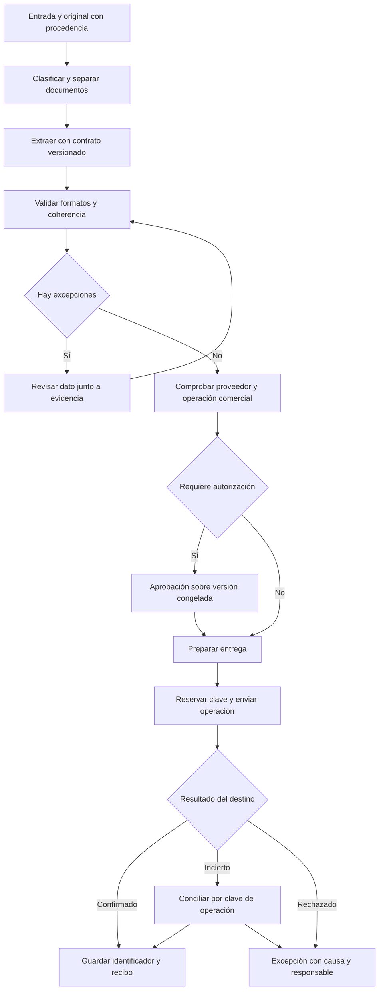

# Rossum para extracción y validación de facturas

[Volver al informe principal](00-informe-principal.md).

Fecha de corte: 16 de octubre de 2026. Investigación de documentación pública del fabricante. API documentada: v1; las páginas consultadas no identifican una versión única del producto SaaS.

**No se ejecutó Rossum con una cuenta ni con facturas.** Los hechos de este informe describen contratos y comportamientos publicados; no constituyen una reproducción del producto. Tampoco se inspeccionó su código privado. Las propuestas de arquitectura y las pruebas son elaboración propia, identificada como tal.

El aprendizaje principal para un gestor documental es separar la extracción, la validación, la aprobación y la entrega al sistema destino. Una cifra puede estar bien leída y seguir sin ser admisible para contabilización. El diseño derivado que se propone aquí conserva la evidencia de cada decisión y trata la entrega como una operación verificable.

## Qué conviene estudiar de Rossum

Rossum permite organizar el procesamiento en colas con campos y automatización configurables; la revisión muestra los datos extraídos y admite corregirlos sobre el documento o escribiéndolos. Su guía inicial documenta importación por interfaz, correo y API, y descarga en XLSX, CSV, XML o JSON. Es un referente pertinente para la entrada de documentos transaccionales y la resolución de excepciones. [Getting Started with Rossum](https://knowledge-base.rossum.ai/help/docs/getting-started-with-rossum)

**Delimitación del benchmark:** este análisis no demuestra capacidades de archivo histórico, conservación legal, retención inmutable o expediente empresarial. Tampoco mide exactitud de OCR, rendimiento, tiempo ahorrado ni costo por factura. No se trasladan porcentajes comerciales a resultados propios.

## Modelo de objetos documentado

| Concepto  | Hecho documentado                                                                                                                                                             | Consecuencia de diseño propuesta                                                       |
| --------- | ----------------------------------------------------------------------------------------------------------------------------------------------------------------------------- | -------------------------------------------------------------------------------------- |
| Documento | Representa un archivo de entrada; conserva nombre, tipo MIME, contenido y vínculos a anotaciones. Puede registrar el correo de origen y un archivo padre, por ejemplo el ZIP. | Conservar el original y su procedencia independientemente de la extracción.            |
| Anotación | El ciclo de procesamiento se aplica a la anotación asociada al documento dentro de una cola.                                                                                  | Dar identidad propia a cada procesamiento; no identificar todo con el nombre del PDF.  |
| Cola      | Agrupa trabajo con esquema, automatización y extensiones.                                                                                                                     | Usarla como configuración operativa, sin asumir que equivale por sí sola a un permiso. |
| Esquema   | Define campos, estructura y representación de datos exportados. Admite secciones, valores, listas y tablas.                                                                   | Separar contrato de datos de la instancia extraída.                                    |

Fuentes: [Document](https://elis.rossum.ai/api/docs/openapi/api/document/), [Annotation Lifecycle](https://elis.rossum.ai/api/docs/openapi/guides/annotation-lifecycle/), [Getting Started](https://knowledge-base.rossum.ai/help/docs/getting-started-with-rossum), [Queue Schema](https://elis.rossum.ai/api/docs/openapi/guides/queue-schema/).

La referencia del documento distingue motivos de filtrado en la entrada por correo, como tamaño, formato, nombre, archivo protegido o imagen dañada. No todo archivo recibido implica una anotación procesable. [Document](https://elis.rossum.ai/api/docs/openapi/api/document/)

### Evolución del esquema

Editar el esquema existente transforma todas sus anotaciones asociadas, incluidas las exportadas y eliminadas. Crear otro esquema y vincularlo a la cola conserva las anteriores con su esquema previo. Los campos nuevos de anotaciones ya exportadas pueden quedar vacíos o con valor predeterminado. Además, la estructura genérica admite más combinaciones que las soportadas por la interfaz. Un campo oculto puede seguir almacenado y exportarse. [Queue Schema](https://elis.rossum.ai/api/docs/openapi/guides/queue-schema/)

**Inferencia:** una edición que parece administrativa puede cambiar cómo se representa una factura histórica. Para el producto propio conviene guardar la versión del contrato y una copia de los datos efectivamente enviados, además del dato vigente. Ocultar un campo debe resolverse separadamente de autorizar su lectura o exportación.

## Ciclo de procesamiento

Los nombres siguientes son estados publicados, no nombres propuestos para el producto propio. La tabla resume su significado; no pretende enumerar todas las transiciones posibles. [Annotation Lifecycle](https://elis.rossum.ai/api/docs/openapi/guides/annotation-lifecycle/)

| Estado          | Significado documentado                           |
| --------------- | ------------------------------------------------- |
| `created`       | Creación manual previa a la importación.          |
| `importing`     | Extracción en proceso.                            |
| `failed_import` | Importación fallida.                              |
| `split`         | División que produjo nuevas anotaciones.          |
| `to_review`     | Extracción terminada; espera revisión.            |
| `reviewing`     | Revisión en la interfaz.                          |
| `in_workflow`   | Flujo en curso; contenido no modificable.         |
| `confirmed`     | Confirmación; requiere habilitación en cola.      |
| `rejected`      | Rechazo; requiere habilitación en cola.           |
| `exporting`     | Espera de finalización del guardado del conector. |
| `exported`      | Validación y hooks superados.                     |
| `failed_export` | Error de exportación.                             |
| `postponed`     | Trabajo aplazado.                                 |
| `deleted`       | Eliminación.                                      |
| `purged`        | Solo metadatos conservados; estado terminal.      |

La guía desaconseja cambiar únicamente el estado mediante PATCH: deben preferirse las operaciones específicas que actualizan sus atributos relacionados. [Annotation Lifecycle](https://elis.rossum.ai/api/docs/openapi/guides/annotation-lifecycle/)

**Inferencia:** la interfaz debe ofrecer acciones con precondiciones y efectos definidos. Un selector libre de estados permitiría saltarse validaciones y dejar fechas, responsables o trazas incoherentes. El estado exportado tampoco prueba por sí mismo una contabilización correcta: depende de qué verificaciones haga la integración.

## Confianza y aceptación de datos

### Lo que significa la confianza

La guía API describe `rir_confidence` entre 0 y 1, aproximadamente calibrado como probabilidad de acierto; advierte que algunos motores dedicados con pocos datos pueden no estar calibrados. El umbral puede configurarse por cola o campo. Superarlo no significa que la precisión de todos los campos aceptados sea igual al umbral. Las fuentes de validación incluyen confianza, comprobaciones y revisión humana. [Automation](https://elis.rossum.ai/api/docs/openapi/guides/automation/)

La guía de usuario distingue marcas de validación automática y humana, y permite consultar su origen. También advierte que entrenar con correcciones humanas y automatizarlo todo plantean una tensión: quedan menos documentos revisados para aprender. [Guide to Automation Process](https://knowledge-base.rossum.ai/docs/guide-to-automation-process-in-rossum)

Hay una **discrepancia documental**: la guía API publica 0,8 como predeterminado; la guía de usuario actualizada el 25 de marzo de 2026 publica 97,5 %. No he verificado cuál aplica a una cuenta, motor o cola concretos. Ninguno debe convertirse en valor universal de una implementación. [Automation](https://elis.rossum.ai/api/docs/openapi/guides/automation/), [Guide to Automation Process](https://knowledge-base.rossum.ai/docs/guide-to-automation-process-in-rossum)

### Por qué una factura puede quedar detenida

La referencia expone un objeto específico para bloqueos. Diferencia problemas del documento y del campo, con identificación del campo, ejemplos y detalles. Incluye confianza baja, errores, comprobaciones fallidas, ausencia de fuentes de validación, confirmación humana requerida, duplicados, propuesta de edición y extensiones. Los ejemplos pueden truncarse a diez y se indica esa truncación. [Automation Blocker](https://elis.rossum.ai/api/docs/openapi/api/automation-blocker/)

La guía API declara que los errores de validación bloquean la exportación automática incluso en automatización completa. En ese modo puede vaciar campos no obligatorios erróneos y volver a validar. También declara que los campos ocultos no participan en esa validación. [Automation](https://elis.rossum.ai/api/docs/openapi/guides/automation/)

**Inferencia:** para automatizar con control hay que conservar tres respuestas distintas: qué se leyó, por qué se aceptó y qué impidió continuar. Un simple indicador de confianza pierde información. El dato vacío tampoco debe mezclarse con cero, ausencia legítima, valor descartado o error de interpretación.

### Reglas de negocio y líneas de factura

La extensión Business Rules Validation permite verificar cabeceras y líneas, condicionar reglas y limitar sus colas. Un error impide confirmar; una advertencia o información permite continuar. El parámetro de bloqueo de automatización puede detener el procesamiento aunque el mensaje permita confirmación manual; la documentación limita ese mecanismo a puntos de datos individuales. [Business Rules Validation Extension](https://knowledge-base.rossum.ai/docs/business-rules-validation-extension)

La función Rules & Actions separa condiciones TxScript y acciones por cola; permite generación asistida desde lenguaje natural, edición manual y prueba sobre documentos antes de guardar. Exige al menos una acción habilitada. Distingue acciones dinámicas, que revierten visibilidad o etiquetas al cambiar la condición, de acciones puntuales que no se revierten. Esa diferencia debe probarse al corregir datos durante la revisión. [Rules & Actions](https://knowledge-base.rossum.ai/docs/rules-in-rossum)

La página de comprobaciones incorporadas está marcada **obsoleta** desde la versión consultada, actualizada el 14 de abril de 2026. Describe relaciones aritméticas entre base, impuesto, total, cantidades y líneas; también documenta que una comprobación negativa puede bloquear aun con confianza alta. Sirve como antecedente de diseño, no como garantía de funcionamiento actual. [Built-in Checks Overview](https://knowledge-base.rossum.ai/docs/built-in-checks-overview)

La guía de líneas documenta exigir al menos una fila mediante `min_occurrences`. Sin embargo, contiene una contradicción interna: primero afirma devolver confianza para cabeceras y líneas y después dice que no se están devolviendo esas puntuaciones. Sus recetas basadas en umbral cero o comprobaciones antiguas requieren verificación por motor y configuración antes de aplicarlas. [Automating Line Items](https://knowledge-base.rossum.ai/docs/automating-line-items)

**Propuesta para facturas:** evaluar en capas separadas la calidad de extracción, el formato, la consistencia aritmética, la coincidencia con el maestro de proveedores, la referencia comercial y la autorización. Una suma correcta no prueba que el proveedor, la moneda o el beneficiario sean correctos. Las reglas aritméticas necesitan tolerancias explícitas para redondeo y casos de abono; este informe no atribuye tolerancias concretas a Rossum.

## Revisión humana y aprobación

La interfaz documentada permite corregir por selección visual, ajuste del recuadro y escritura directa. [Getting Started](https://knowledge-base.rossum.ai/help/docs/getting-started-with-rossum) El teclado distingue avanzar secuencialmente con Tab y saltar a campos pendientes con Enter. En tablas ofrece navegación con flechas, adición de filas y copia vertical; una tecla muestra recuadros sugeridos. [Keyboard Shortcuts](https://knowledge-base.rossum.ai/help/docs/keyboard-shortcuts)

**Aprendizaje de interacción:** mostrar juntos el documento y el dato reduce la necesidad de cambiar de contexto. La navegación por excepciones puede reducir trabajo repetido, pero debe dejar visible qué campos fueron omitidos por una validación automática y cómo inspeccionarlos. No se midió aquí la mejora de productividad.

La aprobación publicada permite pasos y condiciones sobre datos extraídos o introducidos. Mientras se aprueba, el documento queda de solo lectura. Al finalizar pasa al estado configurado; un rechazo lo deriva al correspondiente estado. Un administrador puede actuar o reasignar solicitudes de otros usuarios. Hay una opción para confirmar saltándose el flujo, configurable por cola y deshabilitable a petición. [Approval Workflows](https://knowledge-base.rossum.ai/help/docs/approval-workflows-in-rossum)

La guía API presenta esa función como beta y de habilitación explícita, con recursos de configuración de solo lectura; distingue la ejecución del flujo y su actividad. Esto debe comprobarse en la cuenta contratada, ya que la base de conocimiento presenta también su uso como complemento. [Workflow Guide](https://elis.rossum.ai/api/docs/openapi/guides/workflow-guide/)

**Inferencia:** validar que una cifra coincide con la imagen y autorizar una compra son decisiones diferentes. El permiso para eludir un flujo debe quedar identificado y auditable. Si el contenido cambia después de una aprobación, el sistema propio debería invalidarla o solicitar una nueva según una política explícita.

## Duplicados

La detección inicial compara el hash del archivo. La extensión admite criterios por campos extraídos, nombre y relaciones; combina reglas y permite buscar por cola, espacio u organización, estados y período. Puede marcar, trasladar, mostrar mensajes o detener automatización. El fabricante advierte que las importaciones concurrentes pueden no detectarse completamente y que los documentos duplicados procesados se facturan. [Duplicate Handling Extension](https://knowledge-base.rossum.ai/docs/duplicate-handling-extension)

**Inferencia:** deben distinguirse dos problemas. Un duplicado binario repite bytes; un duplicado comercial puede llegar con otro escaneo, nombre o formato. Detectar candidatos sirve para revisión, pero no reemplaza una restricción transaccional que impida registrar dos veces la misma operación en el destino.

**Propuesta propia:** calcular candidatos con identificación fiscal del proveedor, número normalizado, tipo documental y sociedad receptora; no usar esa combinación como regla definitiva sin validar los casos de numeración repetida, abonos y correcciones. La normalización debe conservar el valor original. Antes de contabilizar, reservar una clave comercial en una operación atómica y registrar conflictos para revisión.

## Extensiones y entrega al sistema destino

### Eventos y orden

Rossum documenta webhooks, funciones dentro de su plataforma y conectores. Recomienda webhooks para implementaciones nuevas. Los eventos cubren importación, inicio y cambios de revisión, confirmación, exportación y cambios de estado. Las operaciones interactivas no tienen los mismos reintentos que las no interactivas. [Extensions](https://elis.rossum.ai/api/docs/openapi/guides/extensions/)

El contrato Hook permite declarar dependencias con `run_after`. Puede entregar al hook un token asociado a un usuario definido como propietario; si no se define, no genera ese token. La duración máxima publicada es de 7.200 segundos, y un administrador de grupo de organizaciones no puede ser propietario de ese token. [Hook](https://elis.rossum.ai/api/docs/openapi/api/hook/)

**Inferencia:** el orden de validación, enriquecimiento y entrega debe ser explícito. Cada extensión necesita conocer qué versión de los datos recibe y qué autoridad utiliza. No debe heredarse una capacidad administrativa solo por comodidad de integración.

### Reintentos

La guía documenta un timeout predeterminado de 30 segundos y hasta cinco intentos para webhooks no interactivos. En ejecución asíncrona, el servicio responde 202 con una dirección de consulta; Rossum consulta cada 30 segundos hasta recibir 201 o agotar el plazo. Determinados errores de consulta se reintentan; algunos fallos pueden repetir la llamada original. [Extensions](https://elis.rossum.ai/api/docs/openapi/guides/extensions/)

El contrato permite configurar hasta cuatro reintentos adicionales. El plazo de consulta tiene predeterminado de 300 segundos y máximo de 3.600, configurable solo para ciertos eventos. La opción de repetir tras fallo de consulta está activada por defecto. [Hook](https://elis.rossum.ai/api/docs/openapi/api/hook/)

**No se verificó una garantía de entrega exactamente una vez ni una clave nativa de idempotencia.** La repetición documentada obliga a diseñar un receptor capaz de reconocer una operación ya realizada. Un timeout deja incierto si el destino guardó los datos antes de perderse la respuesta.

### Qué significa una exportación correcta

El pipeline publicado separa preparación de formato, envío, extracción de datos de la respuesta y evaluación del resultado; las extensiones se encadenan. Puede conservar, por ejemplo, el identificador devuelto por el sistema destino. [Export Pipelines](https://knowledge-base.rossum.ai/docs/export-pipelines)

La extensión REST API Export tiene una condición crítica: **sin configurar el resolvedor, considera exitosos todos los códigos HTTP del envío**. Permite clasificar códigos como error o advertencia; lo demás cuenta como éxito. Esto no se aplica a la solicitud de autenticación. Puede guardar cuerpo y cabeceras de la respuesta para evaluación posterior. [REST API Export](https://knowledge-base.rossum.ai/docs/rest-api-export)

**Propuesta propia:** confirmar el negocio con evidencia del destino, no solo con una llamada terminada. Conservar clave de idempotencia, versión del contenido, intento, identificador externo y respuesta de aceptación. Si el resultado es incierto, consultar por la clave antes de reenviar. La semántica de un 202 del ERP debe ser pendiente hasta comprobar el procesamiento final.

## Permisos y trazabilidad

La documentación de usuarios distingue anotador, gestor, administrador, aprobador y otras variantes; describe un gestor con alcance de colas concretas. También publica matrices diferentes para interfaz y API. Hay discrepancias dentro de la misma página: presenta Viewer como incapaz de cambiar objetos, pero marca carga por API; para Annotator Limited el texto y la tabla tampoco coinciden plenamente. La variante limitada sigue señalada como beta y no recomendada para producción. [Manage Users](https://knowledge-base.rossum.ai/docs/how-to-manage-users)

**Consecuencia:** no se puede certificar aislamiento real leyendo el nombre del rol ni observando botones. La prueba debe usar la misma identidad contra interfaz, API, descarga, búsqueda y relaciones entre documentos. Estas contradicciones se registran como incertidumbre de documentación, no como vulnerabilidades reproducidas.

La referencia Audit Log limita su acceso a administradores y administradores de grupo; publica retención de un año y excluye cambios de representantes de Rossum efectuados mediante sistemas internos. Registra acciones seleccionadas y datos de correlación. [Audit Log](https://elis.rossum.ai/api/docs/openapi/api/audit-log/)

Hook Run documenta registros de ejecución con solicitud y respuesta cuando se habilita su captura, estado, código HTTP y tiempos; su retención es de siete días. [Hook Run](https://elis.rossum.ai/api/docs/openapi/api/hook-run/)

**Inferencia:** los registros de depuración y la auditoría de negocio cumplen propósitos distintos. El producto propio necesita una política de conservación que cubra cambios de datos, reglas y permisos; no debería depender exclusivamente del registro temporal de integraciones.

## Límites técnicos publicados

| Aspecto | Límite publicado                                            | Prueba necesaria en una cuenta                   |
| ------- | ----------------------------------------------------------- | ------------------------------------------------ |
| Archivo | 40 MB; también para tamaño descomprimido de ZIP.            | Casos justo por debajo y por encima.             |
| Correo  | 50 MB del mensaje crudo, incluidos adjuntos codificados.    | Diferenciar tamaño del PDF y del correo.         |
| ZIP     | Menos de 1.000 archivos y reglas de profundidad de carpeta. | Archivo anidado, vacío y con formatos mezclados. |

Fuente: [Import and Export](https://elis.rossum.ai/api/docs/openapi/guides/import-and-export/).

La guía general publica un límite global predeterminado de 600 solicitudes por minuto, respuesta 429 y espera indicada por `Retry-After`. Las listas usan cursores opacos y deben recorrerse por los enlaces entregados. Añadir campos o valores de enumeración se considera compatible: el consumidor debe tolerar valores futuros. [Overview](https://elis.rossum.ai/api/docs/openapi/guides/overview/)

Estos límites corresponden a la documentación consultada; no son mediciones ni condiciones verificadas para un contrato particular.

## Arquitectura conceptual propuesta para aprender del benchmark

El diagrama siguiente es una **propuesta propia**. No representa los servicios privados, las tablas ni la infraestructura de Rossum.

### Contratos que conviene separar

| Contrato propio propuesto | Evidencia mínima que debe conservar                                                                           |
| ------------------------- | ------------------------------------------------------------------------------------------------------------- |
| Entrada                   | Canal, fecha, identidad del original, relación con archivo padre y resultado de aceptación.                   |
| Extracción                | Documento, versión del esquema, valor original, valor normalizado, posición, motor y confianza cuando exista. |
| Validación                | Regla y versión, resultado, campos afectados, causa, revisión humana y excepciones autorizadas.               |
| Aprobación                | Versión aprobada, identidad, alcance de autoridad, decisión y fecha.                                          |
| Entrega                   | Destino, clave comercial e idempotente, contenido congelado, intentos, resultado e identificador externo.     |

El estado visible debería derivarse de estos hechos. Cambiar una regla no debe reescribir silenciosamente qué regla permitió una entrega anterior. Corregir una extracción tampoco debe borrar el dato previo que explica una decisión.

### Prioridad de aprendizaje

1. **Primero, la trazabilidad del dato:** origen, corrección y motivo de aceptación. Es la base para explicar errores y mejorar extracción.
2. **Después, las excepciones:** causas estructuradas y revisión junto al documento, con decisiones recuperables.
3. **Luego, la entrega:** idempotencia, respuesta comercial y conciliación de resultados inciertos.
4. **Finalmente, aumentar automatización:** solo tras medir errores del conjunto que realmente se autoacepta.

Este orden es una recomendación para desarrollar el producto propio; no es un plan de despliegue aprobado ni una modificación realizada.

## Pruebas pendientes para una validación real

Todas las pruebas siguientes están **sin ejecutar**. Requieren una cuenta autorizada, configuración inventariada y datos sintéticos o anonimizados. Los casos de entrega se deben dirigir a un receptor de pruebas, sin contabilización ni avisos a personas reales.

| Caso                     | Qué preparar                                                    | Evidencia que decidiría el resultado                                                  |
| ------------------------ | --------------------------------------------------------------- | ------------------------------------------------------------------------------------- |
| Factura legible          | Cabecera, varias líneas y valores de referencia revisados.      | Valores, posiciones, confianza, validaciones y estado final.                          |
| Error con confianza alta | Variar una cifra que rompe la suma, manteniendo legibilidad.    | Bloqueo por regla separado del score; ninguna aprobación implícita.                   |
| Falta frente a cero      | Campo ausente, cero explícito y texto ilegible.                 | Diferencias conservadas en datos y motivos de decisión.                               |
| Líneas incompletas       | Omitir una fila o dejar descripción vacía.                      | Aplicación real de mínimos y reglas de líneas en el motor seleccionado.               |
| Escaneo distinto         | Dos imágenes de la misma operación.                             | Diferencia entre candidato binario y comercial; explicación del criterio.             |
| Carrera de duplicados    | Importar simultáneamente dos copias en un entorno aislado.      | Anotaciones creadas, candidato detectado y ausencia de doble alta en receptor.        |
| Respuesta perdida        | Receptor guarda y luego no devuelve respuesta.                  | Reintentos, misma clave y una sola operación comercial.                               |
| Rechazo del destino      | Responder con 400, 409, 429 y 500 por separado.                 | Resultado con resolvedor explícito y contraste controlado sin resolvedor.             |
| Recepción asíncrona      | Destino devuelve 202 y termina después.                         | Distinción entre recibido y aceptado comercialmente.                                  |
| Cambio de esquema        | Editar uno existente y después vincular otro.                   | Efecto en documentos anteriores, especialmente exportados.                            |
| Cambio tras aprobación   | Modificar un dato relevante cuando el flujo lo permita.         | Bloqueo o nueva aprobación según configuración comprobada.                            |
| Permisos                 | Identidades de cada rol en colas de prueba.                     | Matriz interfaz/API/descarga y acceso cruzado, incluyendo discrepancias documentales. |
| Recuperación             | Fallo de importación, extensión y exportación.                  | Acción de reanudación, identidad y conservación de trazas sin doble ejecución.        |
| Límites y paginación     | Archivos de frontera y suficientes objetos para varias páginas. | Error preciso, cobertura completa y respeto de la espera en 429.                      |

### Métricas propuestas

No hay cifras medidas en este informe. Para una comparación reproducible registrar:

- Exactitud por campo y por factura completa frente a una referencia humana independiente.
- Proporción automatizada y errores dentro de ese subconjunto; no solo exactitud global.
- Falsos positivos y falsos negativos de duplicados, incluyendo concurrencia.
- Tiempo de revisión humana y tiempo total hasta aceptación del destino; separar espera y trabajo activo.
- Facturas con entrega incierta, reintentos y altas duplicadas.
- Consumo de páginas, llamadas y costo contratado, sin inferirlo del nombre de la función.

El conjunto debe incluir proveedores frecuentes y nuevos, escaneos, PDF digitales, varias páginas, tablas partidas, monedas y separadores decimales diversos, abonos y documentos ajenos a facturación. El tamaño de muestra debe decidirse según la precisión estadística buscada; aquí no se inventa un tamaño representativo.

## Fuentes y vigencia

Todas las fuentes son públicas y del fabricante. Consulta: 16 de octubre de 2026. «Sin fecha» significa que la página consultada no mostraba fecha de actualización; no significa que su contenido esté vigente para todas las cuentas.

| Fuente                                                                                                     | Fecha mostrada         | Uso en este análisis                               |
| ---------------------------------------------------------------------------------------------------------- | ---------------------- | -------------------------------------------------- |
| [Getting Started](https://knowledge-base.rossum.ai/help/docs/getting-started-with-rossum)                  | 2025-08-05             | Objetos operativos y revisión.                     |
| [Document](https://elis.rossum.ai/api/docs/openapi/api/document/)                                          | Sin fecha; API v1      | Archivo y procedencia.                             |
| [Queue Schema](https://elis.rossum.ai/api/docs/openapi/guides/queue-schema/)                               | Sin fecha; API v1      | Estructura y cambios de esquema.                   |
| [Annotation Lifecycle](https://elis.rossum.ai/api/docs/openapi/guides/annotation-lifecycle/)               | Sin fecha; API v1      | Estados y acciones.                                |
| [Automation](https://elis.rossum.ai/api/docs/openapi/guides/automation/)                                   | Sin fecha; API v1      | Confianza y restricciones.                         |
| [Guide to Automation Process](https://knowledge-base.rossum.ai/docs/guide-to-automation-process-in-rossum) | 2026-03-25             | Revisión y discrepancia del umbral.                |
| [Automation Blocker](https://elis.rossum.ai/api/docs/openapi/api/automation-blocker/)                      | Sin fecha; API v1      | Causas de bloqueo.                                 |
| [Business Rules Validation](https://knowledge-base.rossum.ai/docs/business-rules-validation-extension)     | 2025-09-11             | Severidad y bloqueo.                               |
| [Rules & Actions](https://knowledge-base.rossum.ai/docs/rules-in-rossum)                                   | 2026-01-22             | Condiciones, acciones y prueba previa.             |
| [Built-in Checks Overview](https://knowledge-base.rossum.ai/docs/built-in-checks-overview)                 | 2026-04-14; obsoleta   | Antecedentes aritméticos y limitación de vigencia. |
| [Automating Line Items](https://knowledge-base.rossum.ai/docs/automating-line-items)                       | Publicación 2025-07-09 | Líneas y contradicción interna.                    |
| [Keyboard Shortcuts](https://knowledge-base.rossum.ai/help/docs/keyboard-shortcuts)                        | 2025-04-01             | Navegación por excepciones.                        |
| [Approval Workflows](https://knowledge-base.rossum.ai/help/docs/approval-workflows-in-rossum)              | 2025-10-24             | Aprobación y posibilidad de bypass.                |
| [Workflow Guide](https://elis.rossum.ai/api/docs/openapi/guides/workflow-guide/)                           | Sin fecha; beta        | Límites de configuración publicada.                |
| [Duplicate Handling](https://knowledge-base.rossum.ai/docs/duplicate-handling-extension)                   | 2025-04-27             | Criterios y concurrencia.                          |
| [Extensions](https://elis.rossum.ai/api/docs/openapi/guides/extensions/)                                   | Sin fecha; API v1      | Eventos, orden y reintentos.                       |
| [Hook](https://elis.rossum.ai/api/docs/openapi/api/hook/)                                                  | Sin fecha; API v1      | Autoridad y límites de ejecución.                  |
| [Export Pipelines](https://knowledge-base.rossum.ai/docs/export-pipelines)                                 | 2025-09-15             | Composición de entrega.                            |
| [REST API Export](https://knowledge-base.rossum.ai/docs/rest-api-export)                                   | 2025-09-15             | Criterio de éxito HTTP.                            |
| [Manage Users](https://knowledge-base.rossum.ai/docs/how-to-manage-users)                                  | 2026-07-21             | Roles y discrepancias interfaz/API.                |
| [Audit Log](https://elis.rossum.ai/api/docs/openapi/api/audit-log/)                                        | Sin fecha; API v1      | Alcance y retención.                               |
| [Hook Run](https://elis.rossum.ai/api/docs/openapi/api/hook-run/)                                          | Sin fecha; API v1      | Trazas de integración.                             |
| [Import and Export](https://elis.rossum.ai/api/docs/openapi/guides/import-and-export/)                     | Sin fecha; API v1      | Ingesta y límites.                                 |
| [Overview](https://elis.rossum.ai/api/docs/openapi/guides/overview/)                                       | Sin fecha; API v1      | Versionado, paginación y tasa.                     |

Límite de acceso documental: las referencias completas Annotation, Queue y Annotation Content superaron el límite de tamaño de la herramienta de consulta; no se usaron para afirmar detalles adicionales. Una imagen firmada de Rules devolvió 403 y no se utilizó. Las guías y referencias citadas sí aportaron texto accesible. No hubo llamadas a API autenticada, creación de cuenta, envío de mensajes ni cargas de facturas.

El siguiente paso verificable es ejecutar la matriz anterior en una cuenta y receptor de pruebas autorizados; mientras tanto, las conclusiones permiten diseñar los contratos y evitar trasladar supuestos no comprobados.
