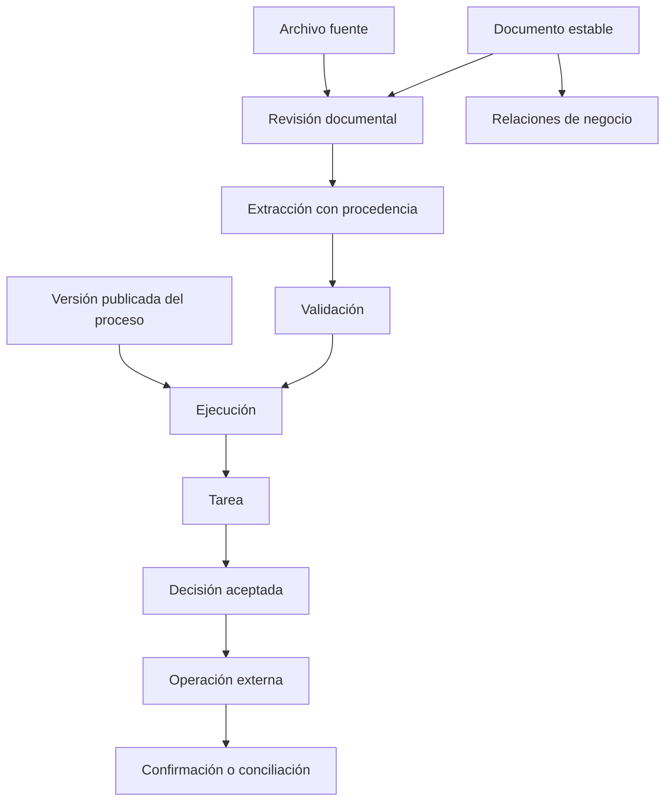
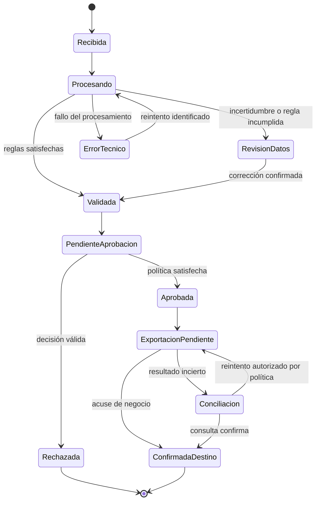
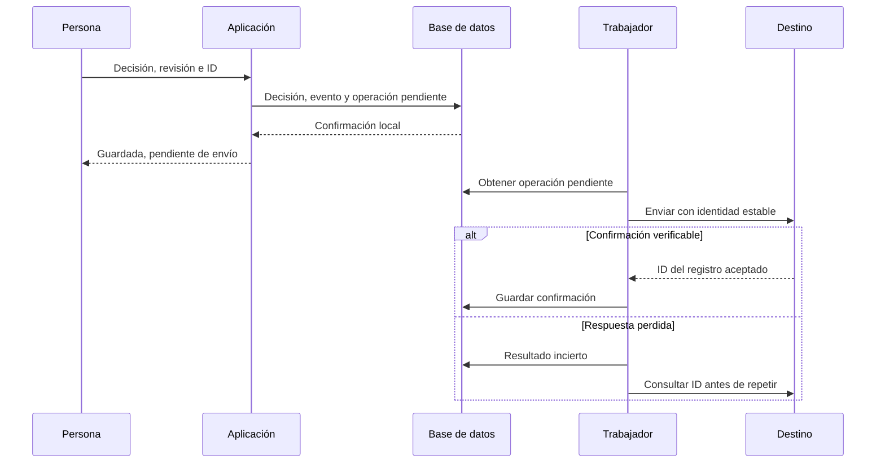

# Arquitectura conceptual derivada del benchmark

**Esta es una propuesta, no una descripción del producto del usuario ni una implementación recuperada de los proveedores.** No se ha identificado ni inspeccionado aquí el repositorio de su gestor documental. No se ha creado ninguna tabla, servicio, integración ni pantalla. [Volver al informe principal](00-informe-principal.md).

La recomendación es conservar los aprendizajes por capacidad: configuración publicable de [DocuWare](01-docuware.md), límites entre recursos de [Mayan](02-mayan-edms.md), contexto y permisos de [M-Files](03-m-files.md), y separación entre extracción, validación y exportación de [Rossum](04-rossum.md). No asumir que sus modelos de autorización o de estado son intercambiables.

## 1. Unidades que conviene separar

| Unidad propuesta      | Qué representa                                           | Por qué no mezclarla                                                            |
| --------------------- | -------------------------------------------------------- | ------------------------------------------------------------------------------- |
| Documento             | Identidad estable del expediente documental              | Renombrar o reemplazar un archivo no debería crear otra identidad por accidente |
| Archivo fuente        | Bytes recibidos, digest, formato y procedencia           | El original debe poder distinguirse de una representación PDF o un OCR          |
| Revisión documental   | Composición visible y metadatos relevantes en un momento | Aprobar una revisión no debería aprobar silenciosamente la siguiente            |
| Objeto de negocio     | Proveedor, contrato, pedido o expediente relacionado     | Una misma entidad puede conectar muchos documentos                              |
| Extracción            | Resultado de un motor sobre una revisión exacta          | Un resultado viejo no debe sobrescribir el resultado de otra revisión           |
| Validación            | Decisión sobre campos o reglas, con su evidencia         | Confianza del motor y conformidad de negocio son cosas distintas                |
| Definición de proceso | Regla que se prepara, revisa y publica                   | Editar una definición no debería reinterpretar decisiones anteriores            |
| Ejecución             | Aplicación de una versión de proceso a un caso           | Necesita su propio estado e historial                                           |
| Tarea y decisión      | Trabajo asignado y resolución efectivamente aceptada     | Reasignar no es aprobar y abrir no es completar                                 |
| Operación externa     | Intención y resultado de un efecto en otro sistema       | Un timeout no demuestra ni fracaso ni éxito                                     |
| Evento de auditoría   | Explicación persistida de un cambio relevante            | El historial visible no debería depender solo de nombres editables              |

Estos nombres son de la propuesta. No se atribuyen a tablas reales de ningún producto.

## 2. Reglas que protegerían la coherencia

1. **Una decisión refiere a lo revisado.** Conservar revisión documental, datos considerados y versión de regla. Si cambia el total, el beneficiario o el contenido relevante, una política explícita decide si invalida aprobaciones. Esa política todavía debe acordarse con el negocio.
2. **La misma petición no crea dos decisiones.** La API debería recibir identidad de operación y versión esperada del estado. Una actualización condicional evita aceptar dos decisiones incompatibles sobre una tarea ya cerrada.
3. **El estado y su auditoría se guardan juntos.** La escritura de decisión, avance de ejecución y evento local necesita una transacción. Las llamadas externas van después mediante una cola persistida de operaciones pendientes.
4. **El fallo externo no borra la historia.** Conservar intentos y resultado incierto. Antes de reintentar una operación que pudo ejecutarse, consultar o deduplicar en destino.
5. **Cada resultado derivado pertenece a una entrada.** Identificar extracción por revisión, digest, motor y configuración. Una respuesta tardía sobre V1 no debe modificar V2.
6. **Relacionar no concede acceso automáticamente.** Evaluar el permiso del destino al navegar, buscar, descargar, exportar o ver OCR. Una relación puede ser visible sin que deba ser visible su contenido; la política debe definir qué información revela.
7. **Una regla publicada es identificable y recuperable.** Las instancias en curso no deberían adoptar cambios por el solo hecho de editar el diseñador. Las migraciones de instancias serían operaciones explícitas y auditadas.
8. **Eliminar conserva significado.** Separar papelera, purga, retención y bloqueo de conservación. Restaurar no debe repetir efectos externos sin una decisión expresa del proceso.

Son requisitos propuestos. No son garantías observadas en los cuatro productos.

## 3. Autorización que se pueda explicar

Antes de elegir el mecanismo, decidir qué significa una concesión y qué significa una restricción. La documentación de [DocuWare](https://knowledgecenter.docuware.com/docs/assigning-rights) establece derechos aditivos; la revisión de [M-Files](03-m-files.md) muestra combinaciones restrictivas y excepciones. Trasladar una regla de uno al otro sin explicitarla cambia el acceso efectivo.

La propuesta es que la misma política central evalúe objeto, acción, actor, ámbito y contexto, con una explicación legible: vías de concesión, restricciones aplicadas y versión de política. Esa evaluación debe utilizarse en todas las vías de acceso, no solo para esconder botones.

Separar las acciones leer contenido, buscar, leer metadatos, editar metadatos, descargar, ver versiones, decidir una tarea, administrar permisos y publicar procesos. **La lista es un punto de partida propuesto**, no un catálogo de permisos descubierto en el producto del usuario.

Una persona que puede completar una tarea podría necesitar acceso acotado al documento durante esa tarea. Debe quedar definido qué dura ese acceso, qué versiones puede ver, si incluye descarga y qué sucede al reasignar. La identidad técnica debe registrar en nombre de quién actuó.

Si en otra tarea se implementa en Supabase, aplicar el estándar del proyecto: esquema y usuario propios, pertenencia a la app, RLS desde el inicio y Storage privado; seleccionar proyecto y confirmar ubicación antes de crear infraestructura. Este documento no autoriza ni ejecuta esa conexión.

## 4. Estados de ejemplo para una factura

El diagrama siguiente es **un ejemplo propuesto**, no los nombres reales de DocuWare, Mayan, M-Files o Rossum. Distingue extracción fallida, dato por revisar, decisión de gasto y confirmación externa.

No añadir «pagada» solo porque hubo exportación. Si se necesita ese estado, debe venir de una confirmación verificable del sistema responsable del pago.

## 5. Extracción con revisión humana

Para cada dato propuesto conviene conservar valor original, valor normalizado, posición en la fuente, revisión de entrada, motor/configuración, confianza disponible y modificaciones humanas. «Desconocido», «vacío», «no aplica» y «cero» deben ser representaciones distintas.

Separar validaciones de formato, aritmética, maestro de proveedores, consistencia entre documentos y política de aprobación. Un total bien leído puede corresponder al proveedor equivocado; una suma correcta puede esconder una línea duplicada.

La automatización debería justificarse por reglas y por resultados medidos en un corpus, no por copiar un porcentaje de otra instalación. Una configuración debe declarar qué campos impiden el procesamiento automático, cómo trata un fallo de búsqueda externa y cómo se revierten cambios de esquema. Los casos se especifican en [el protocolo](06-protocolo-de-pruebas.md).

## 6. Integración con confirmación de negocio

No se ha implementado ni ejecutado este flujo. El contrato del destino puede no admitir idempotencia o consulta por identidad; en ese caso debe quedar una conciliación manual explícita en lugar de prometer exactamente una vez.

## 7. Orden sugerido para aplicar aprendizajes

| Orden | Resultado concreto                            | Criterio para avanzar                                              |
| ----- | --------------------------------------------- | ------------------------------------------------------------------ |
| 1     | Inventario del flujo actual y sus identidades | Seguir un documento hasta una decisión sin perder versión ni actor |
| 2     | Reglas de autorización y auditoría            | Misma decisión en búsqueda, detalle, descarga, OCR y API           |
| 3     | Aprobación con proceso versionado             | Editar una regla no cambia silenciosamente expedientes activos     |
| 4     | Integraciones recuperables                    | Repetir o perder una respuesta no duplica una operación            |
| 5     | Extracción y validación de facturas           | Medición por campo y por documento con verdad de referencia        |
| 6     | Configuración avanzada y expansión            | El beneficio está demostrado por tareas reales del usuario         |

Es una prioridad técnica provisional, no una estimación de duración ni un diagnóstico de la app actual. No se asignaron puntos comerciales ni un ganador general porque no se midieron los cuatro sistemas con el mismo corpus.

## 8. Qué evitar copiar

Evitar nombres mutables como identidad, un único estado que mezcle validación con aprobación, permisos aplicados solo a listados, reintentos ciegos, reglas históricas que cambien al editar una plantilla y la suposición de que terminar OCR significa obtener texto útil.

Evitar también reproducir de inmediato todo el configurador de un producto grande. Primero debe ser posible explicar una decisión y corregir un fallo con un caso real. El benchmark entrega criterios y límites; no exige sustituir el producto existente.
