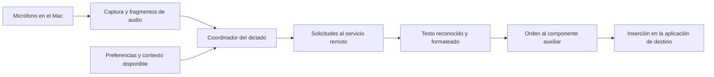

# Wispr Flow: componentes y base para construir una versión propia

**Estado: aún no hay una aplicación propia ejecutable.** Este documento entrega el desglose comprobado del cliente y una propuesta de construcción. La ingeniería inversa sigue siendo parcial.

Analizado: Wispr Flow 1.6.1167 instalado en el Mac. Fecha: 16 de octubre de 2026.

## Qué resultado buscamos

Convertir el estudio de Wispr en una aplicación propia que permita hablar y obtener texto en otra aplicación. El usuario ya proporcionó el objetivo y el programa instalado. No necesita ejecutar comandos ni demostrar que su Wispr funciona.

REA es la herramienta de análisis. La aplicación equivalente requiere un desarrollo posterior. No se ha demostrado que podamos reproducir exactamente la apariencia, calidad, velocidad o todas las funciones de Wispr.

## Qué obtuvimos de la aplicación

Se pudo leer su código JavaScript empaquetado, identificar módulos y estudiar funciones concretas. Las copias conservan su procedencia y sus huellas. Es código distribuido con la aplicación, con nombres parcialmente minificados; no se ha recuperado el proyecto original de desarrollo.

El mapa siguiente resume rutas presentes en el código. No es una captura de una sesión real y omite rutas alternativas:

## Componentes identificados

La columna de reconstrucción describe trabajo propuesto, no componentes nuevos ya implementados.

| Componente                               | Comprobado en el cliente de Wispr                                                                                                                                                                          | Trabajo para una aplicación propia                                                                                                                        | Evidencia |
| ---------------------------------------- | ---------------------------------------------------------------------------------------------------------------------------------------------------------------------------------------------------------- | --------------------------------------------------------------------------------------------------------------------------------------------------------- | --------- |
| Captura del micrófono                    | Usa `getUserMedia`, un procesador `AudioWorklet` y mensajes de inicio, fragmentos y finalización. Hay rutas para WAV y Opus.                                                                               | Implementar un grabador con selección de micrófono, inicio, parada y cancelación.                                                                         | F1        |
| Coordinación del dictado                 | Asocia paquetes y respuestas a una sesión; contempla finalización, errores y rutas alternativas.                                                                                                           | Implementar sesiones que eviten mezclar audio o texto de dictados distintos.                                                                              | F2        |
| Comunicación con el procesamiento de voz | Hay transporte gRPC y rutas HTTP alternativas. La ruta activa en la sesión del usuario no se verificó.                                                                                                     | Conectar un motor de transcripción propio o elegido para la nueva app. No se ha seleccionado ni contratado uno.                                           | F2, F3    |
| Contexto                                 | Los serializadores contemplan aplicación activa, idiomas, diccionario y texto circundante. El texto del campo depende, entre otras condiciones, de la preferencia `useAxContext` y de que pueda obtenerse. | Definir qué contexto necesita la versión propia, cuándo se recoge y a qué procesamiento se entrega.                                                       | F3        |
| Transcripción y formato                  | El cliente solicita pasos de transcripción y alineación; añade formato o cambios de capitalización según condiciones. Distingue texto reconocido, texto formateado y texto para pegar.                     | Implementar o integrar reconocimiento y formato con contratos separados. Las instrucciones y modelos internos del servidor de Wispr no se han recuperado. | F3, F4    |
| Inserción del resultado                  | El cliente conserva el texto actual del portapapeles y manda una orden `PasteText`, con texto y HTML opcional, a su componente auxiliar.                                                                   | Implementar una integración propia con macOS y verificar inserción, foco y permisos. El interior del auxiliar de Wispr no se ha descompilado.             | F5        |
| Ventanas y controles                     | El inventario contiene entradas de interfaz llamadas `hub`, `status`, `overlay` y otras.                                                                                                                   | Estudiar las pantallas pertinentes y diseñar los controles de la aplicación propia. La coincidencia visual aún no está analizada.                         | F6        |

## Qué podemos concluir y qué no

**Observado:** el cliente prepara solicitudes de audio y contexto, procesa respuestas remotas y coordina su inserción. Esto permite reconstruir responsabilidades e interfaces entre componentes.

**Inferencia de implementación:** se puede usar ese desglose como base para desarrollar una alternativa. Para que funcione por cuenta propia habrá que proporcionar el procesamiento de voz/texto y la integración con macOS. Esa alternativa todavía no se ha implementado ni validado.

**Desconocido:** modelos y parámetros del servidor, instrucciones internas de formato, rutas activas de la cuenta, funcionamiento interno del auxiliar nativo y equivalencia de resultados. Un método denominado `_runOpenAIFallback` no demuestra qué modelo se usa realmente.

No se han hecho llamadas de dictado al servicio de Wispr durante este análisis. No se ha verificado un cargo adicional o descuento de cuota por la prueba que se había propuesto.

## Primera versión propuesta

Objetivo verificable: iniciar un dictado, capturar voz, obtener texto y colocarlo en el campo elegido de otra aplicación del Mac.

Los módulos siguientes son nombres propuestos para organizar el desarrollo:

| Módulo propio         | Entrada                                       | Resultado esperado                                             |
| --------------------- | --------------------------------------------- | -------------------------------------------------------------- |
| Grabador              | Inicio, micrófono seleccionado y finalización | Audio asociado a un identificador de dictado                   |
| Coordinador           | Acciones y eventos de ese dictado             | Estado de captura, procesamiento, entrega o error              |
| Transcriptor          | Audio e idioma solicitado                     | Texto reconocido o error explícito                             |
| Formateador           | Texto reconocido y preferencias autorizadas   | Texto final, conservando el original para comparación          |
| Integración con macOS | Texto final y destino seleccionado            | Confirmación de inserción o explicación del fallo              |
| Interfaz              | Estado y acciones disponibles                 | Controles para iniciar, parar, cancelar y revisar el resultado |

La elección del motor de transcripción y formato queda pendiente. No hay credenciales verificadas ni autorización general para contratar servicios o efectuar llamadas pagadas. No se requieren esas decisiones para continuar estudiando el cliente.

## Orden concreto del trabajo restante

1. Completar el estudio del formato y de la comunicación con el auxiliar nativo, siguiendo las fuentes ya localizadas. Usar observación en ejecución solo para una pregunta concreta que el código no resuelva.
2. Preparar la aplicación propia separada del código de REA. El repositorio actual sigue siendo la herramienta de ingeniería inversa.
3. Implementar grabación y coordinación; verificar que el audio y las cancelaciones se conservan correctamente.
4. Conectar y validar el procesamiento de voz y formato, después de resolver motor, acceso y autorización de cualquier consumo pagado.
5. Implementar la inserción en macOS y verificar el recorrido completo de la nueva aplicación.

Las pruebas finales propuestas corresponden a la aplicación propia: dictado breve, cancelación sin pegado, micrófono no disponible, fallo del procesamiento y cambio de foco entre aplicaciones. Aún no se han ejecutado. No se necesita repetir una prueba básica de que Wispr original dicta para continuar el análisis.

## Fuentes y límites de verificación

Las referencias son locales a este Mac. Las copias del programa y la evidencia bruta están en `.cache/`, excluidas de Git, y no viajan a la nube con el repositorio.

- **F1 — Captura:** módulo 76756 de `.webpack/renderer/hub/index.js`, clase `rb`. [Índice de métodos](../.cache/wispr-analysis/recorder-class-index.json), [llamadas de audio](../.cache/wispr-analysis/audio-call-sites.json) y [procedencia](../.cache/wispr-analysis/hub-module-76756-provenance.json).
- **F2 — Coordinación y transporte:** módulos 64472 y 21237 de `.webpack/main/index.js`; `Qn`, `Wn`, `startGrpcStream` y `sendAudioPackets`. [Procedencia del coordinador](../.cache/wispr-analysis/module-64472-provenance.json) y [del transporte](../.cache/wispr-analysis/module-21237-provenance.json).
- **F3 — Solicitud, contexto y selección de pasos:** módulo 99593; `serializeFlowRequest`, `sendFlowRequest`, `pipelineSteps` y `limitedTextboxContents`; módulo 21237, `getContext`. [Procedencia de solicitudes](../.cache/wispr-analysis/module-99593-provenance.json).
- **F4 — Resultado remoto:** módulo 21237, `processResult`. [Procedencia](../.cache/wispr-analysis/module-21237-provenance.json).
- **F5 — Inserción:** módulo 26181, exportación `pasteTextAndRelaunchHelperIfNeeded`, función `ae`. [Procedencia](../.cache/wispr-analysis/module-26181-provenance.json).
- **F6 — Archivos distribuidos:** [inventario del paquete](../.cache/wispr-analysis/inventory.json).
- **Registro de hallazgos:** [observaciones estáticas y límites](../.cache/wispr-analysis/dictation-findings.json).

La huella SHA-256 del ASAR analizado es `84293f175ce0c4e0db7818b1f1ebfb2eb524a9315f8dfa74439925019e9fb587`; se volvió a comprobar antes de redactar este documento.

REA analizó los primeros tres archivos seleccionados y cuatro copias de módulos posteriores. La cobertura es parcial. El análisis del archivo principal completo agotó su límite de memoria; se conservó ese resultado como parcial. El análisis acotado posterior tuvo cero errores de sintaxis, pero límites de nodos y cero hallazgos automáticos de aplicación: las conclusiones funcionales de este documento proceden de la lectura del código y de su árbol de sintaxis, no de una ejecución observada.

Persisten tres discrepancias entre las huellas declaradas por el paquete y componentes nativos que lo acompañan. La causa no se ha verificado. El intento de inspección de ventanas falló con `timeoutReached`. No se ha observado una sesión real de dictado ni se ha construido una réplica.
