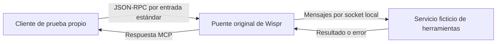

# Wispr Flow: componentes e integración comprobada

**Todavía no hay conexión entre el dictado de Wispr y una aplicación propia. Sí se ejecutó un componente original y pasó ocho comprobaciones locales.**

Analizado: Wispr Flow 1.6.1167 instalado en este Mac. Fecha: 16 de octubre de 2026.

## Objetivo vigente

Probar la ingeniería inversa con REA y encontrar componentes o interfaces para integrar Wispr en las aplicaciones del usuario, manteniendo su suscripción. La propuesta anterior de construir un sustituto queda retirada: no es lo que el usuario busca.

REA permitió estudiar partes del programa distribuido. En esta investigación no produjo una ingeniería inversa perfecta ni recuperó el proyecto original o el código de los servidores. Hubo análisis parcial y lectura manual del JavaScript empaquetado.

## Prueba que ya se ejecutó

Se extrajo de la instalación original `.webpack/main/agentToolBridge.js`, se verificó su huella y se ejecutaron sus bytes sin cambios con Node. Se utilizó un archivo temporal con extensión `.cjs` para conservar el modo CommonJS del componente.

El puente recibe mensajes JSON-RPC por la entrada estándar y convierte llamadas MCP a herramientas en mensajes de un socket local. La prueba creó ese socket y dos herramientas ficticias: una devuelve texto y otra devuelve un error deliberado. No se conectó al proceso de Wispr ni a su servicio remoto.

| Comprobación ejecutada                                    | Resultado                                      |
| --------------------------------------------------------- | ---------------------------------------------- |
| Inicialización e identificación del servidor              | Pasó                                           |
| Consulta del catálogo de herramientas                     | Pasó                                           |
| Comprobación de comunicación con ping                     | Pasó                                           |
| Llamada con texto en español y conservación de argumentos | Pasó                                           |
| Dos llamadas simultáneas, contestadas en orden inverso    | Cada respuesta llegó a su solicitud; pasó      |
| Error de herramienta y argumentos omitidos                | Error explícito y objeto vacío; pasó           |
| Método desconocido                                        | Rechazo JSON-RPC esperado; pasó                |
| Cierre de entrada y terminación del proceso               | Salida 0, sin señal ni errores en stderr; pasó |

**Qué demuestra:** se recuperó y ejercitó un componente real, y conocemos el protocolo de los casos probados. El script de verificación es código propio; el puente ejecutado procede de Wispr.

**Qué no demuestra:** no verifica transcripción, calidad del dictado, acceso de la cuenta, carga de extensiones en Wispr ni integración con una aplicación del usuario. Estas ocho comprobaciones no son una certificación completa de MCP. El puente expone herramientas: no es, por sí solo, un motor de voz ni una API pública de transcripción.

Script repetible: [verify-bridge.mjs](../experiments/wispr-integration/verify-bridge.mjs). Instrucciones y límites: [README del experimento](../experiments/wispr-integration/README.md). Evidencia de la ejecución: [resultado local](../.cache/wispr-integration/verification-1792190379265.json).

## Vías de integración encontradas

| Vía                                     | Evidencia y utilidad                                                                                                                                                               | Estado                                                                            |
| --------------------------------------- | ---------------------------------------------------------------------------------------------------------------------------------------------------------------------------------- | --------------------------------------------------------------------------------- |
| Puente local de herramientas MCP        | Traduce `tools/call` a una llamada de herramienta por socket y devuelve su resultado. Permite estudiar cómo conectar herramientas mediante ese protocolo.                          | Componente real probado con servicio ficticio; no conectado a Wispr en ejecución. |
| Extensiones internas y rutas de dictado | El cliente contiene `registerDictationRoute` y un callback que entrega texto reconocido, texto formateado y contexto. Es una vía candidata para recibir dictados en código propio. | Lectura estática; activación, acceso y estabilidad del contrato sin verificar.    |
| MCP remoto documentado por Wispr        | Acceso de lectura a reuniones, transcripciones de reuniones y notas. No da acceso al historial de dictados.                                                                        | Documentación pública verificada; ninguna cuenta conectada.                       |

La vía remota requiere los accesos de Notetaker y MCP y autorización de la cuenta; esa autorización incluye contenido existente y no se concede por reunión. No se realizó esa conexión. [Documentación oficial de Wispr](https://docs.wisprflow.ai/articles/9551372685-connect-an-mcp-client-to-wispr-flow-remote-mcp-server).

### Contrato interno de dictado observado

La lectura del módulo principal 84797 y de `extensionBootstrap.js` muestra:

- Una extensión registra una ruta mediante `registerDictationRoute(options, callbacks)`.
- El callback `onDictationCompleted` recibe `{ asrText, formattedText, context }`.
- Una respuesta con `action: "paste"` y `text` solicita la ruta de pegado; el manejador principal traduce otras acciones a la salida de la ruta. No se probó el efecto en ejecución.
- `onDictationEnd` es una notificación de finalización: el mensaje observado no incluye la transcripción. Usarlo como si entregara texto sería incorrecto.
- La aplicación empaquetada busca rutas de extensiones configuradas en un archivo `custom-paths.json`. Además mantiene un estado de habilitación por extensión; cuando falta una entrada, la considera deshabilitada. Las extensiones marcadas como vinculadas a cuenta tienen comprobaciones adicionales.

No se leyeron ni cambiaron los archivos de configuración de la cuenta. No se instaló ni habilitó una extensión. En las búsquedas realizadas no se encontró un contrato público de SDK para estas extensiones; no se presentan como una API oficialmente soportada.

## Otros componentes identificados en el cliente

Estas son observaciones del código, no funciones verificadas mediante un dictado real:

| Componente              | Lo observado                                                                                   | Fuente local          |
| ----------------------- | ---------------------------------------------------------------------------------------------- | --------------------- |
| Micrófono               | `getUserMedia`, `AudioWorklet`, fragmentos de audio y fin de grabación                         | Hub 76756, clase `rb` |
| Coordinación            | Sesiones, paquetes de audio y finalización                                                     | Main 64472            |
| Transporte              | gRPC y rutas HTTP alternativas                                                                 | Main 21237 y 99593    |
| Contexto                | Idiomas, diccionario, aplicación y texto circundante según preferencias y disponibilidad       | Main 99593            |
| Transcripción y formato | Solicitudes de pasos de procesamiento; respuesta con texto reconocido, formateado y para pegar | Main 99593 y 21237    |
| Inserción               | Orden `PasteText` al auxiliar nativo                                                           | Main 26181            |
| Interfaz                | Entradas distribuidas `hub`, `status` y `overlay`, entre otras                                 | Inventario ASAR       |

El nombre `_runOpenAIFallback` no identifica el modelo usado realmente. No se recuperaron los modelos, instrucciones privadas o código del servicio remoto. El interior del auxiliar nativo no se ha descompilado.

## Qué falta para una integración real

Para recibir dictados en una aplicación propia, la pista concreta es la ruta de extensiones. Falta comprobar el mecanismo de activación disponible en esta instalación y elegir la aplicación receptora, su dato de destino y un recorrido de prueba. Después habrá que verificar un dictado completo desde Wispr hasta ese destino. La prueba local del puente no sustituye esa comprobación.

El MCP remoto es otra opción si se quieren consultar reuniones y notas. Su alcance documentado no resuelve la entrega del dictado corriente a una aplicación propia.

No se necesita desarrollar un reemplazo, seleccionar otro modelo de voz ni contratar un servicio para continuar investigando estas interfaces. No se han hecho llamadas pagadas durante la prueba local; no se ha verificado qué condiciones comerciales aplicarían a una integración futura.

## Evidencia y límites

- ASAR: SHA-256 `84293f175ce0c4e0db7818b1f1ebfb2eb524a9315f8dfa74439925019e9fb587`.
- Puente ejecutado: SHA-256 `8a9e77a6310d960d5486ed138a591a8185d4cf443b391b3ce069a39364451a2b`.
- El verificador rechaza ejecutar si cambia cualquiera de esas huellas. Es un experimento de esta versión, no un instalador genérico.
- Procedencia de extensiones: [módulo 84797](../.cache/wispr-analysis/module-84797-provenance.json) y [bootstrap](../.cache/wispr-analysis/integration/extensionBootstrap.js.provenance.json).
- [Inventario](../.cache/wispr-analysis/inventory.json), [hallazgos del dictado](../.cache/wispr-analysis/dictation-findings.json) y [resumen REA de módulos](../.cache/wispr-analysis/rea-dictation-summary.json).
- REA analizó los primeros archivos seleccionados y cuatro copias de módulos. Su intento sobre el archivo principal completo agotó el límite de memoria. El análisis posterior tuvo cero errores de sintaxis, pero cobertura parcial y cero hallazgos automáticos de aplicación: las conclusiones funcionales se obtuvieron leyendo el código y su árbol de sintaxis.
- Persisten tres discrepancias de integridad declarada en componentes nativos acompañantes; causa no verificada. Ninguno de esos componentes se ejecutó en esta prueba del puente.
- Las copias del programa, la instalación aislada de REA y los resultados brutos están en `.cache/`, excluidos de Git. No viajan a la nube con el repositorio. No se distribuye código de Wispr como parte del experimento propio.
- No se modificó Wispr, se capturó audio ni se accedió a datos de la cuenta. No hay una pantalla nueva en la vista previa: el entregable es este informe y el experimento ejecutable.
