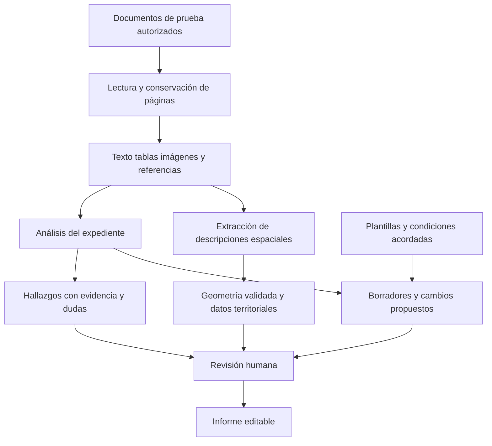

# Orbital y las posibilidades de ingeniería inversa

Consulta: 18 de octubre de 2026. Producto: [Orbital](https://www.orbital.tech/platform).

**La información pública permite reconstruir una especificación funcional y parte de su arquitectura. No permite afirmar que hayamos recuperado su código, sus modelos, sus instrucciones internas o sus datos.** La investigación identifica piezas concretas para una implementación propia; todavía no hay una réplica ni una integración funcionando.

Orbital se presenta como una plataforma de trabajo jurídico inmobiliario: reúne documentos de una operación, relaciona sus condiciones, conecta derechos con mapas, prepara borradores y coordina la revisión. La página facilitada corresponde a su oferta comercial estadounidense. Tiene páginas separadas para Reino Unido. No he verificado soporte para Colombia ni para documentos jurídicos en español. [Plataforma](https://www.orbital.tech/platform), [oferta británica](https://www.orbital.tech/uk).

## Qué hace el producto

Las siguientes funciones están **declaradas por Orbital**. Se verificó que las publica, pero no se ejecutaron con una cuenta de cliente.

| Módulo                        | Entradas y funciones publicadas                                                                                                                                         | Resultado anunciado                                                                                                                                                                              |
| ----------------------------- | ----------------------------------------------------------------------------------------------------------------------------------------------------------------------- | ------------------------------------------------------------------------------------------------------------------------------------------------------------------------------------------------ |
| Análisis documental           | Títulos, planos, arrendamientos, modificaciones y compraventas; análisis conjunto, recuperación de documentos referenciados e importación desde iManage o NetDocuments. | Hallazgos vinculados al documento original, resúmenes y reportes exportables a Word o Excel. [Fuente](https://www.orbital.tech/platform/asset-intelligence).                                     |
| Visualización de la propiedad | Descripciones de linderos, servidumbres, parcelas y planos; superposición con datos territoriales.                                                                      | Mapa con fuentes, diferencias y anotaciones. Publica capas estadounidenses de inundaciones FEMA y registros ambientales EPA. [Fuente](https://www.orbital.tech/platform/property-visualization). |
| Redacción y negociación       | Condiciones acordadas, formularios propios, precedentes y versiones de contratos.                                                                                       | Borradores, comparación de modificaciones, listas de asuntos y documentos de cierre, con revisión humana y trazabilidad. [Fuente](https://www.orbital.tech/platform/drafting-negotiation).       |
| Coordinación de operaciones   | Proyecto compartido, documentos, comentarios y solicitudes de revisión.                                                                                                 | Seguimiento de revisión, vínculos para compartir y envío por Outlook con historial. [Fuente](https://www.orbital.tech/platform/deal-coordination).                                               |

La relación entre las piezas es la parte valiosa para una reconstrucción: cada hallazgo debería conservar su documento de origen, su ubicación y su relación con el inmueble y la operación. Copiar las pantallas por sí solo no reproduce esa relación. Esta es una conclusión de diseño derivada de las funciones publicadas, no una observación de su base de datos.

## Qué revela su documentación técnica

### Lectura de documentos con estructura

Su CTO explica que el procesamiento conserva disposición de página, tablas, firmas e imágenes, además del texto reconocido. También describe una combinación de modelos de lenguaje, visión clásica y geometría. No identifica en ese artículo el motor OCR, su configuración ni el corpus utilizado. [Artículo técnico del 2 de febrero de 2026](https://tech.orbitalwitness.com/posts/2026-02-02-series-b-in-the-press/).

Para una implementación propia, esto implica preservar coordenadas y referencias al original desde la ingesta: si el sistema pierde ese vínculo al extraer texto, después resulta difícil justificar cada conclusión.

### Modelos distintos según la tarea

Orbital declara que utiliza varios modelos y selecciona cada uno mediante evaluaciones sobre trabajo inmobiliario. Describe comparaciones ciegas, revisión humana, evaluadores basados en modelos y cambios graduales con posibilidad de reversión. Publica una lista histórica de modelos evaluados, experimentados o ajustados; **esa lista no demuestra cuáles están hoy en producción**. Tampoco demuestra precisión en un caso nuevo. [Evaluaciones publicadas el 18 de diciembre de 2025](https://tech.orbitalwitness.com/posts/2025-18-12-real-world-blind-evals/).

La pieza reutilizable es el procedimiento: comparar resultados con respuestas de referencia, comprobar las citas y tratar la información ausente como desconocida. El proveedor o modelo concreto debe decidirse con esa evaluación.

### Trabajos largos que conservan su estado

En julio de 2026 su equipo documentó el uso de **Temporal** para conservar ejecuciones, recuperar resultados de pasos terminados y gestionar reintentos, tiempos máximos y señales de actividad. Cada ejecución fija la versión del cuestionario con la que empezó. También describe control de admisión de trabajos según memoria disponible y límites de conexiones. Son afirmaciones de su equipo, no mediciones realizadas aquí. [No Agent Left Behind](https://tech.orbitalwitness.com/posts/2026-07-06-no-agent-left-behind/).

Para reconstruir este comportamiento hay que separar el estado del trabajo del estado de la pantalla. Cerrar una pestaña o desplegar una versión no debería obligar a empezar de nuevo un análisis terminado parcialmente.

### Conversión de descripciones jurídicas en geometría

Su artículo más concreto descompone el texto en referencias al sistema estadounidense PLSS, instrucciones de rumbos y distancias, y excepciones. Agentes especializados procesan componentes por separado; un plan determina cómo unir, restar o intersectar geometrías. Después se validan resultados, se transforman coordenadas y se comunican fallos parciales. Para PLSS declaran consultar una base de propiedades propia, cuya licencia y contenido no se revelan en el artículo. [Arquitectura geométrica del 1 de enero de 2026](https://tech.orbitalwitness.com/posts/2026-01-01-teaching-ai-to-read-property-boundaries/).

La página actual del producto añade un límite útil: cuando no puede ubicar una descripción automáticamente, la coloca el usuario. Permite elegir la descripción principal y conserva alternativas; el plano topográfico sigue siendo la referencia que indica el fabricante. [Property Visualizer](https://www.orbital.tech/platform/property-visualization).

### Edición de documentos y razonamiento visual

Una publicación describe agentes que proponen cambios por secciones de Word y un agente superior que los integra y revisa. También explica un ciclo de dibujar sobre un mapa, capturar su imagen y analizarla. El artículo incluye sistemas construidos y en desarrollo; no demuestra que cada automatización esté disponible para todos los clientes. [Descripción técnica del 8 de julio de 2026](https://tech.orbitalwitness.com/posts/2026-07-08-would-you-trust-an-agent-to-buy-your-house/).

## Qué se pudo observar directamente

Se recorrió en Chrome la web pública real, desde la plataforma hasta la demostración y el inicio de sesión:

- **Plataforma:** presenta los cuatro módulos anteriores y enlaces separados por región.
- **Demostración enlazada:** lleva al [webinar de septiembre](https://www.orbital.tech/webinar/september-on-demand), que muestra un formulario con datos personales y empresariales. No se completó ni envió; no se vio la demostración.
- **Inicio de sesión:** abrió una pantalla de Orbital Copilot con correo, contraseña y acceso por cuenta de organización. No había una sesión autenticada disponible en ese recorrido; no se introdujeron credenciales.

Esto comprueba la navegación pública y la barrera de acceso. **No comprueba carga de documentos, análisis, mapas, exportaciones, calidad jurídica, tiempos ni consumo de cuotas.** Las imágenes promocionales no se trataron como pantallas operadas.

No se ejecutó REA sobre los recursos de la web comercial: analizar esos recursos no establecería cómo funciona el motor privado. La evidencia de esta fase procede de documentos públicos y del navegador; no hay registros Evidence de REA que prueben ejecución del producto.

## Hasta dónde llega la ingeniería inversa

| Pregunta                                                           | Resultado de esta investigación                                                                                                        |
| ------------------------------------------------------------------ | -------------------------------------------------------------------------------------------------------------------------------------- |
| ¿Se puede definir qué construir?                                   | Sí, una especificación inicial por módulos y entradas/salidas, con las funciones publicadas como referencia.                           |
| ¿Se conoce su implementación completa?                             | No. Hay explicaciones técnicas parciales; no se obtuvo el repositorio del producto.                                                    |
| ¿Se pueden recuperar los modelos, instrucciones y reglas privadas? | No se han recuperado. La web no aporta esos artefactos.                                                                                |
| ¿Se puede extraer el motor del servidor desde el navegador?        | Inspeccionar el cliente no equivale a recuperar la implementación del servidor; en esta fase tampoco se obtuvo el cliente autenticado. |
| ¿Hay una API pública utilizable?                                   | No se localizó documentación de API en las fuentes oficiales revisadas. Eso no demuestra que no exista.                                |
| ¿Se pueden reutilizar sus datos o componentes?                     | No se ha verificado ninguna licencia que permita hacerlo; tampoco se obtuvieron esos datos o componentes.                              |
| ¿Se conocen precios y costos de una integración?                   | No se verificaron tarifas, cuotas ni condiciones de API. No hay una estimación fiable de costo o plazo para replicar todo el producto. |

Orbital declara cifrado, SSO, MFA, certificaciones ISO 27001:2022 y SOC 2 Type 2, y que no utiliza documentos de clientes para entrenar modelos. No se inspeccionaron certificados ni se auditó su implementación. [Seguridad publicada](https://www.orbital.tech/security).

## Propuesta de reconstrucción por piezas

Esta propuesta es una arquitectura propia, **no un esquema extraído del código de Orbital**. No implica que se haya autorizado implementar una aplicación, conectar servicios o comprar datos.

La primera pieza que propongo es **revisión documental con citas y reporte editable**. Permite comprobar valor con un expediente acotado antes de abordar mapas y coordinación externa. Para Colombia habría que definir por separado documentos, preguntas, fuentes y validación jurídica locales; las reglas estadounidenses y británicas descritas aquí no verifican su aplicabilidad.

| Pieza propuesta                 | Contrato de salida propio                                                       | Criterio de prueba propuesto                                                                         |
| ------------------------------- | ------------------------------------------------------------------------------- | ---------------------------------------------------------------------------------------------------- |
| Lector documental               | Contenido por página con referencia al original y avisos de lectura incompleta. | Un documento escaneado o incompleto no produce una lectura silenciosamente presentada como completa. |
| Analizador de expediente        | Hallazgo, soporte exacto, documentos implicados y dudas pendientes.             | Cada hallazgo se puede contrastar; documentos contradictorios conservan ambas fuentes.               |
| Revisor y generador de reportes | Hallazgos revisados y archivo editable con fuentes.                             | La exportación conserva lo revisado y sus referencias.                                               |
| Comparador y redactor           | Cambios propuestos vinculados a condiciones y versión de origen.                | No desaparecen cláusulas ajenas al cambio ni se mezclan versiones.                                   |
| Motor espacial                  | Geometría, sistema de coordenadas, fuente y límites de ubicación.               | Un lindero sin referencia suficiente queda pendiente de ubicación; no se inventa.                    |
| Coordinador                     | Estado del expediente, tareas e historial.                                      | Los cambios y accesos se atribuyen correctamente; cualquier envío real requiere autorización.        |

Estos contratos son sugerencias de implementación. No son nombres de tablas, columnas ni contratos API observados en Orbital.

## Cómo contrastarlo con el producto real

El siguiente nivel requiere una cuenta o demo utilizable y documentos de prueba autorizados. No basta con que exista una suscripción: antes de ejecutar análisis debe conocerse si la prueba consume cuota o genera cargos.

1. Crear un expediente aislado y cargar un documento con contenido conocido.
2. Ejecutar una revisión concreta y contrastar cada hallazgo con página y fragmento original.
3. Añadir una modificación contradictoria y comprobar cómo conserva versiones y evidencia.
4. Marcar un hallazgo, editarlo y exportarlo; verificar el archivo descargado.
5. Si se incluye cartografía, usar una descripción con geometría conocida y otra incompleta.
6. Registrar pasos, resultados y tiempos reales. Conservar capturas técnicas sin credenciales para un análisis posterior con REA, si ayudan a responder una pregunta concreta.

La fase pública queda documentada. La prueba de punta a punta del producto permanece pendiente de acceso y alcance de consumo; no se hicieron llamadas pagadas, envíos a personas ni cambios en Orbital.
